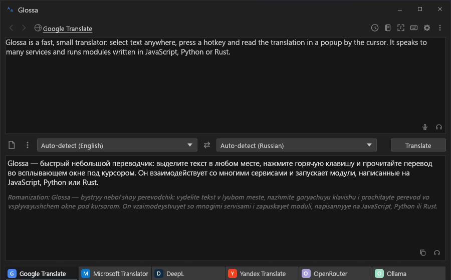
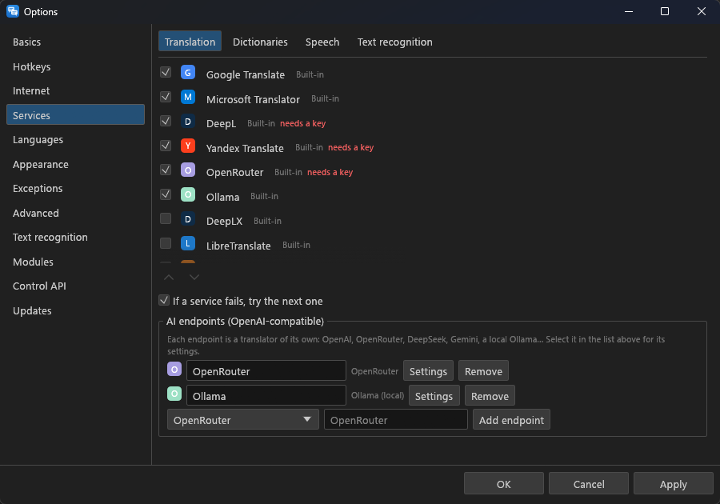
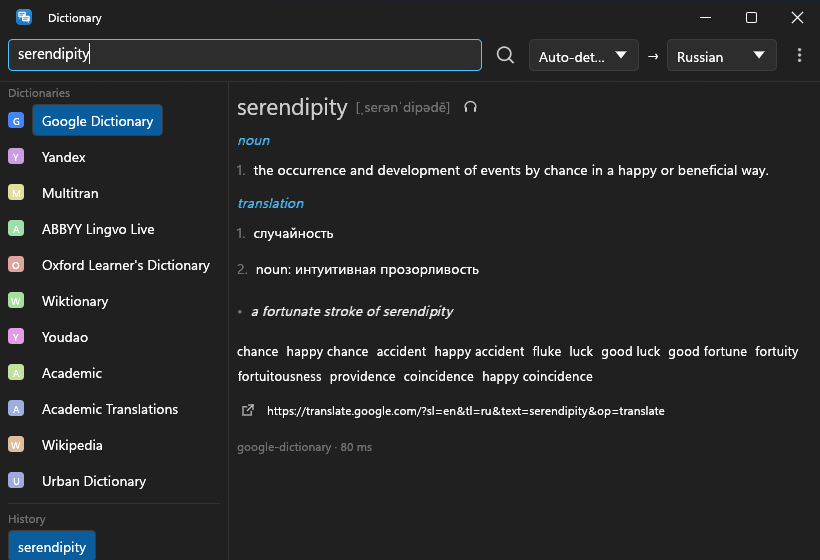
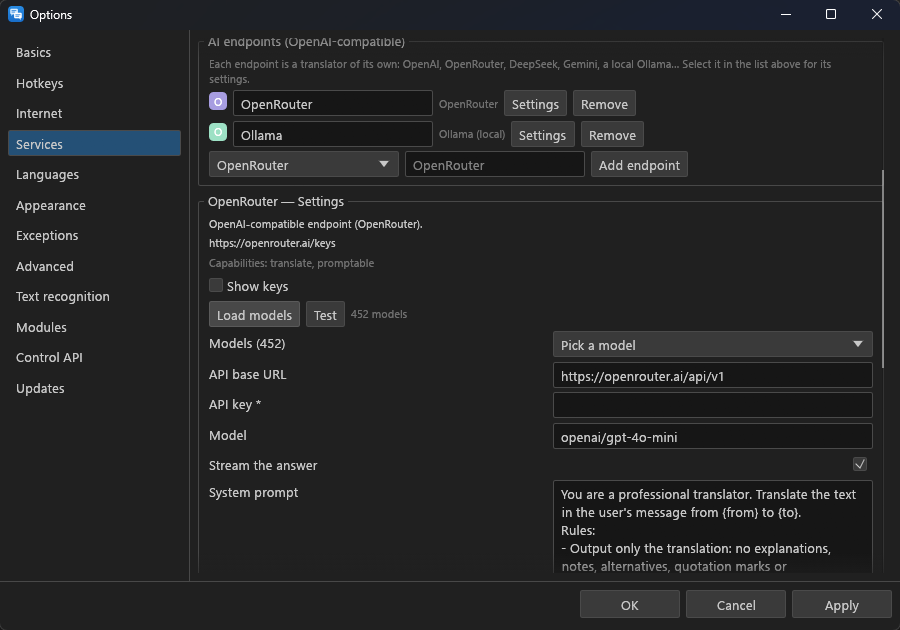

<p align="center">
  
</p>

<h1 align="center">Glossa</h1>

<p align="center">
  <b>A fast, small, extensible desktop translator.</b><br>
  Select text anywhere, press a hotkey, read the translation by the cursor. A clean-room successor to QTranslate, in Rust.
</p>

<p align="center">
  <a href="https://github.com/bropines/glossa/actions/workflows/ci.yml"></a>
  <a href="https://github.com/bropines/glossa/releases/latest"></a>
  <a href="#license"></a>
  
</p>

<p align="center">
  
</p>

<table>
  <tr>
    <td width="33%" valign="top"></td>
    <td width="33%" valign="top"></td>
    <td width="33%" valign="top"></td>
  </tr>
  <tr>
    <td align="center"><sub>The main window</sub></td>
    <td align="center"><sub>AI endpoints from presets</sub></td>
    <td align="center"><sub>Dictionary</sub></td>
  </tr>
</table>

## Contents

- [Features](#features) · [Getting started](#getting-started) · [Coming from QTranslate](#coming-from-qtranslate)
- [AI translators](#ai-translators) · [Modules](#modules) · [Command line](#command-line)
- [Documentation](#documentation) · [Building](#building) · [Status](#status) · [Clean room](#clean-room) · [License](#license)

## Features

- **Translate the selection** in any program: a popup by the cursor, or the
  main window with the source and several services side by side.
- **Recognise text on screen** (OCR) and translate it: drag over a region,
  copy it, or watch it and re-translate when it changes. Google Lens through
  [chrome-lens-py](https://github.com/bropines/chrome-lens-py).
- **Dictionary**: online (Google, Yandex, Multitran, ABBYY Lingvo Live,
  Oxford Learner's, Wiktionary, Youdao, Academic, Wikipedia, Urban
  Dictionary, and the classic dictionary scripts) and offline (StarDict, DSL,
  XDXF, TSV).
- **Listen**: text to speech for the source and the translation.
- **Replace, copy, convert layout**: translate the selection in place, copy
  the translation, fix text typed in the wrong keyboard layout.
- **Many services, built in**: Google, Bing, Yandex, DeepL, Lara, ModernMT
  and MyMemory with no key or account; the DeepL and Yandex Cloud APIs,
  DeepLX, LibreTranslate and Lingva with your own key or server; fail-over
  from one to the next. The keyless web services ship as readable JavaScript
  modules inside the executable ([list](docs/modules/README.md#bundled-modules)).
- **AI translators**: any number of OpenAI-compatible endpoints (OpenAI,
  OpenRouter, DeepSeek, Gemini, Groq, Mistral, a local Ollama or LM Studio),
  made from presets, with the answer streaming into the popup as it is written.
- **Modules** in JavaScript, Python or as native libraries (Rust, C, anything
  with a C ABI), with one protocol for all three. Classic QTranslate services
  and pot-app plugins run unchanged.
- **Themes** as plain files, classic QTranslate themes included; light and
  dark; window and popup transparency; OpenGL, GPU or software rendering.
- **History** with favourites and export (text, CSV, HTML, JSON).
- **Command line and local API**: `glossa-cli` does everything without a
  window; other programs can drive a running Glossa over HTTP on localhost.
- **Small**: a few MB of memory in the tray (the window system unloads when
  nothing is on screen), one 17 MB executable, no web engine, no runtime to
  install.

## Getting started

Download the archive for your system from the
[releases](https://github.com/bropines/glossa/releases), unpack it anywhere
and run `glossa`. It starts in the tray. Select text in any program and press:

| hotkey | does |
|---|---|
| **Ctrl+Shift+Q** | translate the selection in a popup |
| **Ctrl+Alt+Q** | open the main window with the selection |
| **Ctrl+Shift+O** | recognise text in a screen region |
| **Ctrl+Alt+O** | recognise and translate a screen region |
| **Ctrl+E** | read the selection aloud |

All of them, and the actions without a default key, are in *Options →
Hotkeys*. A `portable` file next to the executable keeps the settings beside
it.

For OCR, install chrome-lens-py (`pip install "chrome-lens-py[clipboard]"`);
Glossa finds it, and keeps its daemon warm so a scan takes about 0.4 s.

## Coming from QTranslate

*Options → Modules → Classic QTranslate installation*: pick the folder with
`QTranslate.exe`, and its services, themes and interface languages are used
in place. To bring over the settings and history as well:

```bash
glossa-cli import-classic "C:\Program Files (x86)\QTranslate"
```

The import points each classic service at Glossa's own version of it where
one exists (classic Yandex becomes the keyless Yandex, the DeepL scripts
become DeepL, Multitran, Lingvo, Oxford and the other dictionaries their
bundled modules), so the tabs work without setup. Classic scripts with no
Glossa counterpart still load from the installation.

The popup, the main window and the options pages follow the classic program's
behaviour, studied by observing it ([notes](docs/research/classic-behaviour.md)).

## AI translators

*Options → Services → AI endpoints*: choose a preset, press **Add endpoint**,
paste a key. Each endpoint becomes a translator of its own in the service
strip, with its own model, prompt and settings:

- **Load models** lists what the endpoint offers; **Test** translates a sample
  with the settings as typed.
- Streaming (on by default), temperature or reasoning effort, a token limit,
  a timeout, extra headers and extra JSON request fields.
- `<think>` blocks of local reasoning models are hidden.

<p align="center">
  
</p>

Details: [docs/ai-endpoints.md](docs/ai-endpoints.md).

## Modules

A module is a folder with a `module.toml` and code, dropped into a modules
folder. Glossa calls JavaScript in process, starts Python as a child process
when first needed, and loads native libraries directly; all three get the same
JSON requests and the same host calls (HTTP through Glossa's proxy settings,
limited to the hosts the module declares).

```js
// modules/my-translator/main.js
function translate(req, host) {
  var r = host.fetch("https://api.example.com/translate", {
    method: "POST",
    json: { q: req.text, target: req.to },
  });
  return { text: r.json().translation };
}
```

Start with the [modules overview](docs/modules/README.md). Examples live in
[`modules/`](modules): a dictionary in JavaScript, Python and Rust/C samples,
and a Lens OCR module. The services bundled with Glossa are modules too, in
[`modules/bundled/`](modules/bundled); copying one into your modules folder
and editing it replaces the bundled copy.

## Command line

```bash
glossa-cli translate -t ru "Hello, world"
echo "Bonjour" | glossa-cli translate -t en
glossa-cli translate -s ai-deepseek -t de "streams to the terminal as it is written"
glossa-cli dict -f en -t ru serendipity
glossa-cli ocr screenshot.png -t en
glossa-cli services                  # what is available
glossa-cli action show_popup "text"  # ask the running app to show a popup
```

`glossa-cli` with no arguments lists every command; `--json` gives
machine-readable output.

## Documentation

- [Modules](docs/modules/README.md): guides for
  [JavaScript](docs/modules/js-modules.md), [Python](sdk/python/README.md) and
  [native](docs/modules/native-modules.md) modules, the
  [protocol](docs/modules/protocol.md), and
  [classic QTranslate and pot-app scripts](docs/modules/classic-scripts.md)
- [AI endpoints](docs/ai-endpoints.md)
- [Themes](docs/theming.md)
- [Architecture](docs/architecture.md)
- [How the classic program behaved](docs/research/classic-behaviour.md)
- [Changelog](CHANGELOG.md) · [Contributing](CONTRIBUTING.md) · [Security](SECURITY.md)

## Building

Rust 1.95 or newer.

```bash
cargo build --release -p glossa-ui-egui -p glossa-cli
```

On Linux, install `libgtk-3-dev` and `libasound2-dev` first (Debian and
Ubuntu names). Windows binaries also cross-compile from Linux with the
`x86_64-pc-windows-gnu` target and mingw-w64. See
[CONTRIBUTING.md](CONTRIBUTING.md) and [AGENTS.md](AGENTS.md).

## Status

Working: everything listed under Features, on Windows (tested daily) and
Linux X11; macOS builds but is untested.

Not yet: mouse mode (translate on double-click or selection without a hotkey),
speech input, the update check. On Wayland, global hotkeys and reading the
selection depend on the compositor.

Classic QTranslate service scripts and the keyless bundled services depend on
the websites they talk to; when a site changes, a classic script breaks for
QTranslate and Glossa alike, and a bundled module until it is updated (or
replaced by your own copy). `glossa-cli modules` and `glossa-cli -v` show what
failed and why.

## Clean room

Glossa contains no code from QTranslate. Its behaviour was studied from the
outside: the program's plain-text data files (options, themes, languages, the
JavaScript service scripts and their helper API, which users already edit) and
by observing the running program. Classic scripts and themes are not shipped;
Glossa reads them from an existing installation. See [NOTICE](NOTICE).

Not affiliated with or endorsed by QTranslate or its author.

## License

MIT ([LICENSE-MIT](LICENSE-MIT)) or Apache-2.0
([LICENSE-APACHE](LICENSE-APACHE)), at your option. Third-party notices are in
[NOTICE](NOTICE).
