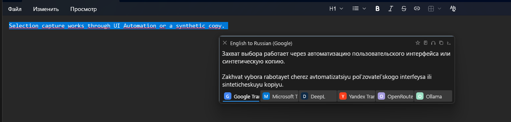
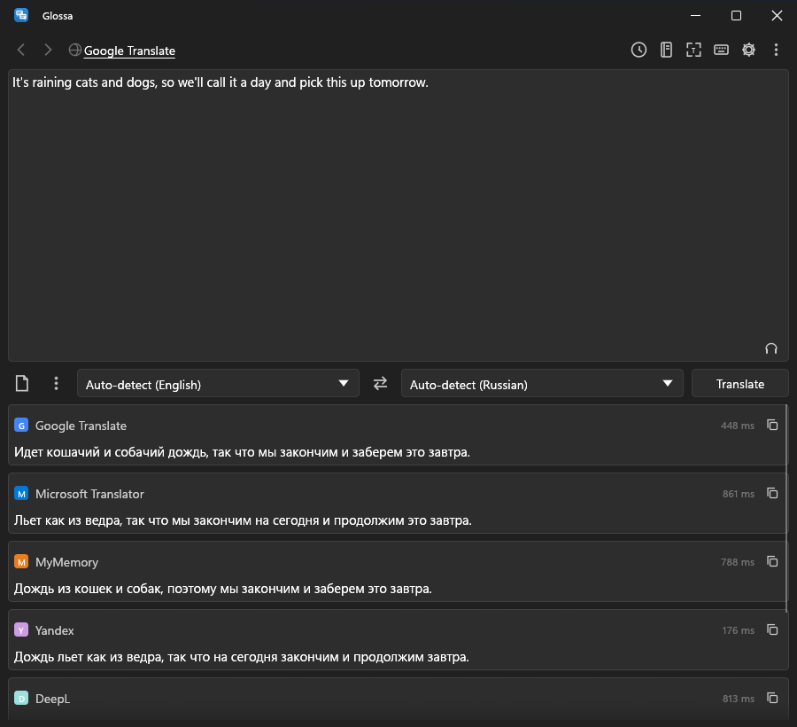
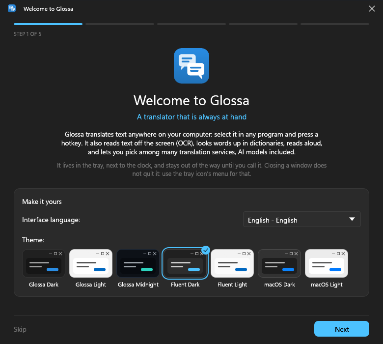
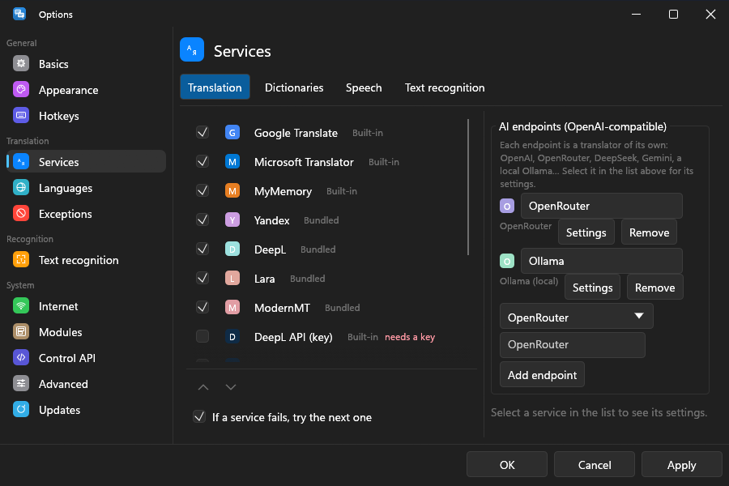
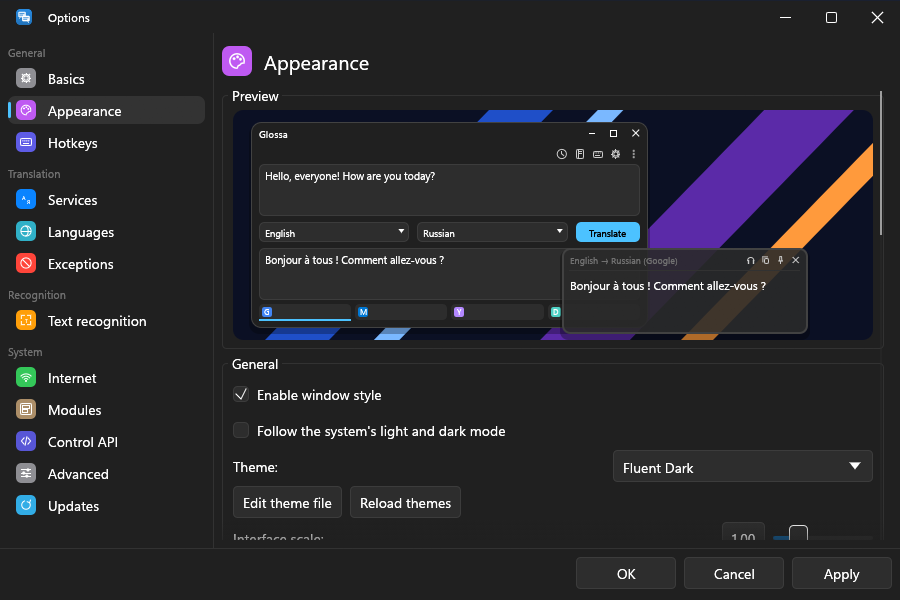
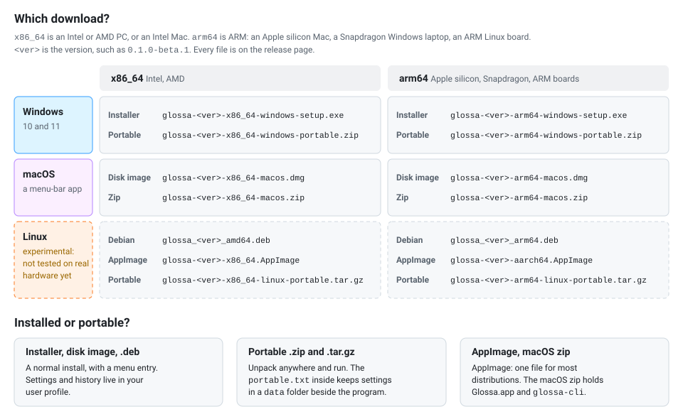

<p align="center">
  
</p>

<h1 align="center">Glossa</h1>

<p align="center">
  <b>A fast, small, extensible desktop translator.</b><br>
  Select text anywhere, press a hotkey, read the translation by the cursor. A clean-room successor to QTranslate, in Rust.
</p>

<p align="center">
  <a href="https://github.com/bropines/glossa/actions/workflows/ci.yml"></a>
  <a href="https://github.com/bropines/glossa/releases"></a>
  <a href="#license"></a>
  
</p>

<p align="center">
  
</p>

<table>
  <tr>
    <td width="33%" valign="top">
      <picture>
        <source media="(prefers-color-scheme: light)" srcset="docs/screenshots/main-light.png">
        
      </picture>
    </td>
    <td width="33%" valign="top">
      <picture>
        <source media="(prefers-color-scheme: light)" srcset="docs/screenshots/main-stacked-light.png">
        
      </picture>
    </td>
    <td width="33%" valign="top">
      <picture>
        <source media="(prefers-color-scheme: light)" srcset="docs/screenshots/dict-light.png">
        
      </picture>
    </td>
  </tr>
  <tr>
    <td align="center"><sub>The main window</sub></td>
    <td align="center"><sub>Every service at once</sub></td>
    <td align="center"><sub>Dictionary</sub></td>
  </tr>
  <tr>
    <td width="33%" valign="top">
      <picture>
        <source media="(prefers-color-scheme: light)" srcset="docs/screenshots/welcome-light.png">
        
      </picture>
    </td>
    <td width="33%" valign="top">
      <picture>
        <source media="(prefers-color-scheme: light)" srcset="docs/screenshots/options-services-light.png">
        
      </picture>
    </td>
    <td width="33%" valign="top">
      <picture>
        <source media="(prefers-color-scheme: light)" srcset="docs/screenshots/options-appearance-light.png">
        
      </picture>
    </td>
  </tr>
  <tr>
    <td align="center"><sub>Welcome guide</sub></td>
    <td align="center"><sub>Services and AI endpoints</sub></td>
    <td align="center"><sub>Appearance</sub></td>
  </tr>
</table>

> **Beta.** Glossa 0.1.0-beta.1 is the first public build. The downloads
> are not signed yet, so Windows and macOS warn on the first launch
> ([how to open them](docs/install.md)). Windows is used daily, macOS is in
> early testing, and Linux has not been tried on real hardware yet.

## Contents

- [Getting started](#getting-started): [download](#download),
  [first translation](#first-translation), [macOS permissions](#macos)
- [Features](#features)
- [Coming from QTranslate](#coming-from-qtranslate)
- [AI translators](#ai-translators) · [Text recognition](#text-recognition) ·
  [Modules](#modules) · [Command line](#command-line)
- [Status](#status) · [Documentation](#documentation) · [Building](#building)
- [Clean room](#clean-room) · [License](#license)

## Getting started

### Download

Take the file for your system from the
[releases](https://github.com/bropines/glossa/releases):

| system | take |
|---|---|
| Windows 10, 11 | the `-windows-setup.exe` installer, or the `-windows-portable.zip` to unpack anywhere |
| macOS | the `.dmg`; move `Glossa.app` to *Applications* |
| Linux (experimental) | the `.deb` on Debian and Ubuntu, otherwise the AppImage or the portable archive |

Each comes for `x86_64` (Intel and AMD) and `arm64` (Apple silicon,
Snapdragon, ARM boards). [Installing](docs/install.md) has every file, the
first-launch warnings, upgrading and removing, and this chart:

<p align="center">
  
</p>

### First translation

Start Glossa. A welcome guide shows the hotkeys and asks where to keep API
keys; after that Glossa waits in the tray (the menu bar on macOS). Select
text in any program and press a hotkey:

| hotkey | on Windows | does |
|---|---|---|
| **Ctrl+Shift+Q** | same | translate the selection in a popup |
| **Ctrl+Alt+Q** | **Win+Alt+Q** | open the main window with the selection |
| **Ctrl+Shift+O** | same | recognise text in a screen region |
| **Ctrl+Alt+O** | **Win+Alt+O** | recognise and translate a screen region |
| **Ctrl+Alt+C** | **Win+Alt+C** | copy the text in a screen region |
| **Ctrl+Alt+S** | **Win+Alt+S** | translate the whole screen in place |

On macOS, Ctrl+Alt is Control+Option. Windows uses Win+Alt because Ctrl+Alt
is what AltGr sends, and those hotkeys would eat characters typed with
AltGr. Every hotkey, and the actions without one (reading the selection
aloud, replacing it with the translation, and more), are in
*Options → Hotkeys*.

The keyless services (Google, Microsoft, Yandex, DeepL and others) work at
once. Services that need a key, and AI endpoints, are set up in
*Options → Services*.

### macOS

macOS asks before a program may read other programs' text or the screen.
*Options → Permissions* shows what is granted, with buttons that ask again or
open the right page of System Settings:

| permission | for |
|---|---|
| **Accessibility** | reading the selected text in other programs and copying or replacing it: the translation hotkeys, and mouse mode |
| **Screen Recording** | capturing a region for text recognition; applies after Glossa restarts |
| **Input Monitoring** | mouse mode's watch on the mouse buttons, only if Accessibility is not granted |

Global hotkeys need none of them. macOS ties a grant to the app's signature:
after replacing Glossa.app with a new build, remove the old Glossa entry from
each list and allow the new one. Opening the unsigned app the first time is
described in [Installing](docs/install.md#macos).

## Features

**Translating**

- **The selection, in any program**: a popup by the cursor, or the main
  window with the source and one service or all of them side by side. The
  popup can be dragged, resized (the size is remembered) and pinned.
- **Mouse mode**, as in QTranslate: select text with the mouse and a button
  by the pointer (or the translation itself) appears, no hotkey needed. A
  click on the tray icon turns it on and off.
- **Replace, copy, convert layout**: translate the selection in place, copy
  the translation, fix text typed in the wrong keyboard layout.
- **Spell checking** in the main window's source pane, with the system's
  own checker and suggestions in the context menu.

**Services**

- **Built in, no key**: Google, Microsoft (Bing), Yandex, DeepL, Lara,
  ModernMT and MyMemory. With your own key or server: the DeepL and Yandex
  Cloud APIs, DeepLX, LibreTranslate, Lingva. When one fails, the next one
  answers.
- **AI translators**: any number of OpenAI-compatible endpoints (OpenAI,
  OpenRouter, DeepSeek, Gemini, Groq, Mistral, a local Ollama or LM Studio),
  made from presets, with the answer streaming in as it is written.
- **Dictionary**: online (Google, Yandex, Multitran, ABBYY Lingvo Live,
  Oxford Learner's, Wiktionary, Youdao, Academic, Wikipedia, Urban
  Dictionary, the classic dictionary scripts) and offline (StarDict, DSL,
  XDXF, TSV).
- **Listen**: text to speech online (Google) or offline with the system's
  own voices (the Windows voices, macOS's `say`, espeak-ng on Linux).

**Text on screen (OCR)**

- Drag over a region to copy its text, translate it, paint the translation
  over the picture, or watch it and translate again when it changes.
- Google Lens is built in and needs nothing installed. Offline: Windows OCR
  and the Snipping Tool's OneOCR on Windows, Apple Vision on macOS,
  Tesseract anywhere. Also AI vision models, modules and any command.

**Looks**

- Themes as plain files, classic QTranslate themes included. Light and dark
  themes that follow the system's mode. Fluent (WinUI 3) themes in the
  system accent colour, and macOS themes after AppKit.
- Mica, Acrylic or blur backdrops and Snap Layouts on Windows 11; vibrancy
  and rounded popups on macOS; window and popup transparency.
- Ctrl+wheel zooms the text areas; OpenGL, GPU or software rendering.

**Extending and scripting**

- **Modules** in JavaScript, Python, Java or any language over stdio, or
  native libraries (Rust, C, anything with a C ABI), with one protocol for
  all of them. Classic QTranslate services and pot-app plugins run
  unchanged.
- **Command line and local API**: `glossa-cli` does everything without a
  window; other programs can drive a running Glossa over HTTP on localhost
  (and D-Bus on Linux).

**Everything else**

- **History** with favourites and export (text, CSV, HTML, JSON).
- **Keys in the system keychain** if you choose: Windows Credential
  Manager, the macOS Keychain or the Secret Service on Linux.
- **Portable**: a copy with a `portable.txt` beside the executable keeps
  its settings in a `data` folder next to it.
- **Small**: a few MB of memory in the tray (the window system unloads when
  nothing is on screen), one executable of about 20 MB, no web engine, no
  runtime to install.

## Coming from QTranslate

*Options → Modules → Classic QTranslate installation*: pick the folder with
`QTranslate.exe`, and its services, themes and interface languages are used
in place. A classic language file is laid over Glossa's own translation
(Russian is built in), so strings the classic program never had are
translated too. To bring over the settings and history as well:

```bash
glossa-cli import-classic "C:\Program Files (x86)\QTranslate"
```

The import points each classic service at Glossa's own version of it where
one exists (classic Yandex becomes the keyless Yandex, the DeepL scripts
become DeepL, Multitran, Lingvo, Oxford and the other dictionaries their
bundled modules), so the tabs work without setup. Classic scripts with no
Glossa counterpart still load from the installation.

The popup, the main window and the options pages follow the classic program's
behaviour, studied by observing it ([notes](docs/research/classic-behaviour.md)).

## AI translators

*Options → Services → Translation*, the *AI endpoints* panel: choose a
preset, press **Add endpoint**, paste a key. Each endpoint becomes a
translator of its own in the service strip, with its own model, prompt and
settings. **Load models** lists what the endpoint offers; **Test**
translates a sample with the settings as typed. Streaming is on by default,
and `<think>` blocks of local reasoning models are hidden.

<p align="center">
  
</p>

Details: [docs/ai-endpoints.md](docs/ai-endpoints.md).

## Text recognition

Press **Ctrl+Alt+O** (Windows: **Win+Alt+O**) and drag over text on the
screen: the result window opens with the text and its translation. Google
Lens does the reading by default, with Glossa's own client: about half a
second, nothing to install. Without a network Glossa falls over to the
system's offline engine. The engines, the actions, copy mode and translating
in place are in [docs/ocr.md](docs/ocr.md).

## Modules

A module is a folder with a `module.toml` and code, dropped into a modules
folder. Glossa calls JavaScript in process, starts Python, Java or any other
program as a child process when first needed, and loads native libraries
directly; all of them get the same JSON requests and the same host calls
(HTTP through Glossa's proxy settings, limited to the hosts the module
declares).

```js
// modules/my-translator/main.js
function translate(req, host) {
  var r = host.fetch("https://api.example.com/translate", {
    method: "POST",
    json: { q: req.text, target: req.to },
  });
  return { text: r.json().translation };
}
```

Start with the [modules overview](docs/modules/README.md). Examples live in
[`modules/`](modules). The services bundled with Glossa are modules too, in
[`modules/bundled/`](modules/bundled); copying one into your modules folder
and editing it replaces the bundled copy.

## Command line

```bash
glossa-cli translate -t ru "Hello, world"
echo "Bonjour" | glossa-cli translate -t en
glossa-cli dict -f en -t ru serendipity
glossa-cli ocr screenshot.png -t en
glossa-cli services                  # what is available
glossa-cli doctor                    # what works on this system
glossa-cli action show_popup "text"  # ask the running app to show a popup
```

`glossa-cli` with no arguments lists every command; `--json` gives
machine-readable output. Every command and flag is in
[docs/cli.md](docs/cli.md); the HTTP API other programs use is in
[docs/control-api.md](docs/control-api.md).

## Status

| system | state |
|---|---|
| Windows 10, 11 | used daily by the author |
| macOS (Apple silicon) | early testing |
| Linux | experimental: builds and passes the tests, not yet tried on a real desktop |

Not implemented yet: speech input, the update check.

On Linux under Wayland, a program cannot do everything it can under X11.
Glossa uses the desktop's portals where they exist: global hotkeys through
GlobalShortcuts (KDE Plasma 6, GNOME 48 and later, Hyprland), screen capture
through Screenshot or `grim`, and copying from and pasting into other
programs through RemoteDesktop (GNOME, KDE Plasma), which asks once.
Elsewhere, bind a desktop shortcut to Glossa's D-Bus service or HTTP API
([how](docs/control-api.md#binding-hotkeys-to-it)). `glossa-cli doctor`
says what works in your session.

Classic QTranslate service scripts and the keyless bundled services depend on
the websites they talk to; when a site changes, a classic script breaks for
QTranslate and Glossa alike, and a bundled module until it is updated (or
replaced by your own copy). `glossa-cli modules` and `glossa-cli -v` show what
failed and why.

## Documentation

All pages, by topic: [docs/README.md](docs/README.md)
([по-русски](docs/README.ru.md)).

| page | what it covers |
|---|---|
| [Installing](docs/install.md) | every download, first launch, upgrading, removing |
| [Text recognition](docs/ocr.md) | engines, copy mode, Lens translation, translating in place |
| [AI endpoints](docs/ai-endpoints.md) | OpenAI-compatible translators |
| [Configuration](docs/configuration.md) | every `config.toml` key, and where the data folder is |
| [Command line](docs/cli.md) | every `glossa-cli` command, flag, exit code and environment variable |
| [Control API](docs/control-api.md) | driving a running Glossa over HTTP or D-Bus; hotkeys on Wayland, macOS, AutoHotkey |
| [Themes](docs/theming.md) | theme files, light and dark, backdrops |
| [Modules](docs/modules/README.md) | writing modules in any language, the protocol, classic scripts |
| [Architecture](docs/architecture.md) | the crates and how a translation flows through them |

[Changelog](CHANGELOG.md) · [Contributing](CONTRIBUTING.md) ·
[Security](SECURITY.md)

## Building

Rust 1.95 or newer.

```bash
cargo build --release -p glossa-ui-egui -p glossa-cli
```

On Linux, install `libgtk-3-dev` and `libasound2-dev` first (Debian and
Ubuntu names). [CONTRIBUTING.md](CONTRIBUTING.md) has the rest, including a
macOS app bundle that keeps its permissions across rebuilds.

## Clean room

Glossa contains no code from QTranslate. Its behaviour was studied from the
outside: the program's plain-text data files (options, themes, languages, the
JavaScript service scripts and their helper API, which users already edit) and
by observing the running program. Classic scripts and themes are not shipped;
Glossa reads them from an existing installation. See [NOTICE](NOTICE).

Not affiliated with or endorsed by QTranslate or its author.

## License

MIT ([LICENSE-MIT](LICENSE-MIT)) or Apache-2.0
([LICENSE-APACHE](LICENSE-APACHE)), at your option. Third-party notices are in
[NOTICE](NOTICE).
