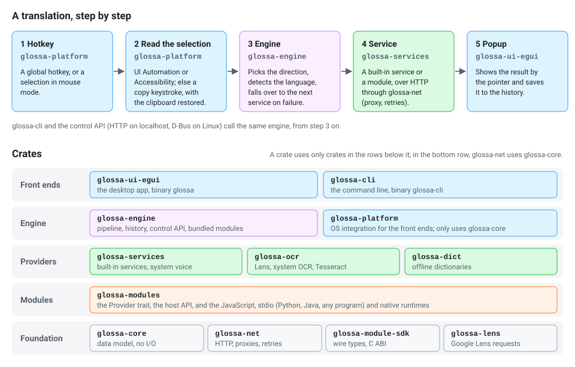

# Architecture

Glossa is a Cargo workspace. The rule that shapes it: **everything a user can
do exists below the UI**. The desktop app, the command line and the control
API are three front ends over one engine, and another toolkit could be a
fourth without touching the rest.

<p align="center">
  
</p>

- [Crates](#crates)
- [Where the systems differ](#where-the-systems-differ)
- [How a translation flows](#how-a-translation-flows)
- [The desktop app and memory](#the-desktop-app-and-memory)
- [Text rendering](#text-rendering)
- [Threads](#threads)
- [Configuration and data](#configuration-and-data)
- [Testing](#testing)

The same dependency graph in text:

```
                       glossa-ui-egui (glossa)      glossa-cli
                             │      │                    │
                 glossa-platform    └──── glossa-engine ─┘
                 (OS integration)          │   │   │   │
                             ┌─────────────┘   │   │   └──────────┐
                     glossa-services   glossa-ocr  glossa-dict    │
                     (built-in APIs)   (OCR; Lens  (StarDict…)    │
                             │          via glossa-lens)          │
                             └───────────┬─────┴───────┘          │
                                   glossa-modules ────────────────┘
                (provider API; JS / stdio: Python, Java, any program / native)
                                   │            │
                              glossa-net   glossa-module-sdk
                                   │        (wire types, C ABI)
                              glossa-core
                 (languages, config, themes, history, errors; no I/O)
```

## Crates

| crate | role |
|---|---|
| `glossa-core` | The domain model: the language table, capabilities, requests and results (including the OCR layout and its hOCR/ALTO/JSON exporters and readers), `config.toml`, which settings are secrets and where they go (`secrets.rs`), themes, locales, history, hotkey and action definitions, the classic-format importers. Pure data and logic: no network, no threads, no UI. |
| `glossa-net` | HTTP on `ureq`: proxies (including the Windows system proxy), timeouts, retries, legacy code pages, an HTTP mock for tests. |
| `glossa-module-sdk` | What a module author depends on: the protocol's wire types, the C ABI (`include/glossa_module.h`), and `export_module!` for Rust modules. Depends on nothing else in the workspace. |
| `glossa-modules` | The `Provider` trait every translator, dictionary, voice and OCR engine implements; the host API given to modules (scoped HTTP, cache, log, and the image API in `image_ops`); the registry that scans module folders; the runtimes: JavaScript (Glossa, classic QTranslate and pot-app dialects, on boa), Python, Java and any other program (`runtime = "process"`) as child processes over one stdio transport, native (shared libraries); `child`, which runs a helper program with a deadline and cancellation for providers built on one. |
| `glossa-services` | Built-in providers in Rust: Google, Google Dictionary, Bing (keyless web session or keyed API), DeepL, DeepLX, LibreTranslate, MyMemory, Lingva, OpenAI-compatible (translation, and text recognition with a vision model in `openai_ocr.rs`), Yandex; and the offline system voice (`system-tts`): WinRT `Windows.Media.SpeechSynthesis` on Windows, `say` on macOS, `espeak-ng` on Linux and the BSDs, in `system_tts/` with one file per system. Like the OS OCR engines, it calls the OS here rather than in `glossa-platform`, which the engine does not depend on. |
| `glossa-lens` | Google Lens requests and replies, on [chrome-lens-rs](https://github.com/bropines/chrome-lens-rs): builds the request Chromium's Lens overlay sends and reads the reply into paragraphs, lines, words and translations. It sends nothing itself; `glossa-ocr` sends the request through Glossa's own HTTP client. |
| `glossa-ocr` | OCR providers: Google Lens (online; the built-in client on `glossa-lens`, with retries and at most two requests at once, or a running chrome-lens-py daemon, or its CLI, by `[ocr.lens] mode`); offline Windows OCR (`Windows.Media.Ocr`) and OneOCR (the Snipping Tool's `oneocr.dll`, loaded from the user's installation, opt-in only) on Windows, Apple Vision (`VNRecognizeTextRequest` via objc2) on macOS, and Tesseract (its CLI with TSV output) anywhere it is installed; and any external command. Modules add more. The OS engines' calls live here behind `cfg(windows)` / `cfg(target_os = "macos")` rather than in `glossa-platform`, which the engine does not depend on (the CLI uses it only for `doctor`). Registration order is the fail-over order (Lens, the system engine, Tesseract, the command); the engine falls over past engines that are not installed. |
| `glossa-dict` | Offline dictionaries (StarDict with dictzip, DSL, XDXF, tab-separated) and the HTML simplifier for dictionary articles. |
| `glossa-engine` | The front ends' shared core: the keyless JavaScript service modules compiled in from `modules/bundled/`, the translation pipeline (direction detection, fail-over, back translation, input limits), async jobs with cancellation, history, the theme and locale catalogues, exports, the classic import, the control API (HTTP on localhost with a token), and on Linux and the BSDs the same actions as a D-Bus service on the session bus (`dbus`, no token). |
| `glossa-platform` | Everything OS-specific: the single-instance lock and hand-over channel, clipboard, reading the selection (UI Automation, then a synthetic copy), synthetic input, screen capture, global hotkeys, the XDG desktop portals that stand in for them on Wayland (GlobalShortcuts, Screenshot, and RemoteDesktop for copy and paste), the mouse watcher for mouse mode, autostart, audio playback, window placement, Snap Layouts for Glossa's own title bar (Windows 11), rounded corners for borderless windows (macOS), window backdrops (Mica, Acrylic, vibrancy), the system accent colour and dark-mode preference, dark or light system menus, spell checking (the Windows Spell Checking API, `NSSpellChecker`, Hunspell dictionaries), the system keychain (Windows Credential Manager, the macOS Keychain, the Secret Service), the idle message pump. |
| `glossa-ui-egui` | The desktop app (binary `glossa`): main window, selection popup, OCR overlay, dictionary, history, options, tray. |
| `glossa-cli` | The command line (binary `glossa-cli`). |

`third_party/eframe` is eframe 0.37 with one fix; see
[../third_party/README.md](../third_party/README.md).

## Where the systems differ

The interface is one program for every system; what sets Windows, macOS
and Linux apart is kept out of it. (Windows is used daily, macOS is in
early testing, and the Linux code passes the automated tests but has not
been tried on a real Linux desktop yet.)


- **`glossa_platform::shell::SHELL`** says how this system's windows behave,
  once per system in `shell/win.rs`, `shell/mac.rs` and `shell/linux.rs`:
  whether desktop coordinates are pixels or points, which corner a window
  keeps when it is resized, whether Glossa may draw its own title bar,
  whether a translucent window needs a translucent main window, whether
  dropdowns should stay inside their window, which renderers show
  backdrops, how the shortcut modifier is named. The UI asks these
  questions (`SHELL.resize_keeps_bottom_left`) and never tests for an
  operating system to decide how windows behave.
- **The implementations** sit with their subject, one file per system. A
  fix for one system goes in that system's file.

  | subject | files |
  |---|---|
  | windows: Glossa's own, monitors, the foreground window | `window/win.rs`, `window/mac.rs` (also rounded corners), `window/snap.rs` (Snap Layouts) |
  | backdrops: Mica and Acrylic, vibrancy, KWin's blur | `backdrop/win.rs`, `backdrop/mac.rs`, `backdrop/x11.rs` |
  | spell checking | `spell/win.rs`, `spell/mac.rs`, `spell/linux.rs` |
  | the keychain | `secrets/win.rs`, `secrets/mac.rs`, `secrets/linux.rs` |
  | the system voice (in `glossa-services`) | `system_tts/win.rs`, `system_tts/mac.rs`, `system_tts/linux.rs` |

What remains behind `cfg` in `glossa-ui-egui` is either platform API with
no common shape (the tray icon's look, font files) or a feature only one
system has (Windows OCR and OneOCR, Apple Vision, the macOS permissions
page).

## How a translation flows

1. A hotkey fires (`glossa-platform::hotkeys`) or the user types.
2. For selection actions the app reads the selection: UI Automation first
   (instant, leaves the clipboard alone), else a synthetic Ctrl+C with the
   clipboard saved and restored. On Wayland the keystroke goes through the
   RemoteDesktop portal (`portal.rs`), which the desktop asks the user to
   allow once; the permission is kept in `remote-desktop-token` in the data
   folder.
3. `Engine::translate_async` runs the pipeline on a worker thread: normalise
   the text, pick the direction (detecting the language when the source is
   *auto*, swapping for "smart" pairs), then try the active service and fall
   over to the next enabled one on failure.
4. A provider is called with a `Host` (scoped HTTP, cache, options). A module
   provider turns the call into a protocol request for its runtime.
5. The result returns as an engine event; the UI shows it and records it in
   history.

The CLI ([cli.md](cli.md)) and the control API ([control-api.md](control-api.md))
call the blocking versions of the same functions.

## The desktop app and memory

The goal is a resident cost close to the classic program's. The app is split
in two:

- **The shell**, which lives as long as the process: the engine, hotkeys, the
  tray icon, the control API (and the D-Bus service), clipboard and audio. In
  the tray it costs a few MB.
- **The GUI**, eframe with its OpenGL (or wgpu) context, fonts and windows,
  which is the expensive part (≈75 MB with OpenGL).

When no window has been visible for `appearance.unload_graphics_after_secs`
(default 45), the GUI shuts down completely and the process waits in a plain
message loop (`glossa-platform::idle`), with its working set trimmed. A
hotkey, a tray click or a control-API or D-Bus call brings it back in a few
hundred milliseconds. Things that must happen before any window exists (reading the
selection, whose focus a new window would steal) are done in that loop.

Other choices made for size: fonts for CJK, Arabic, Indic and other scripts
are loaded only when text in that script first appears; a Python, Java or
process module's process starts on first use and stops when idle; the
renderer is selectable (OpenGL is the lightest).

## Text rendering

egui's text engine (epaint 0.37) shapes text with HarfRust, the Rust port of
HarfBuzz, so scripts that need shaping (Devanagari and the other Indic
scripts, Sinhala, Khmer, Myanmar, Thai, Arabic joining) render correctly
once a font is loaded (`fonts.rs` loads one per script, on first sight). It
does not run the bidirectional algorithm: it guesses one direction per font
run and places runs and wraps rows in logical order.

`glossa-ui-egui/src/bidi.rs` adds that on top, without patching epaint, for
text with right-to-left characters (and for text mixing a script that needs
shaping with another, where one face could cover both):

1. `unicode-bidi` resolves an embedding level per character.
2. The text becomes a `LayoutJob` whose sections never mix levels or
   scripts; right-to-left stretches are cut at spaces, so each word is shaped
   right to left on its own and epaint's logical-order row wrapping is
   right.
3. After layout, each row's runs move into visual order (UAX #9 rule L2) by
   shifting their glyphs and their vertices in the tessellated mesh; lone
   brackets in right-to-left text get the mirrored glyph; the empty padding
   glyphs epaint appends to right-to-left runs are dropped so glyphs pair up
   with characters again. Each section's index rides in the lowest bits of
   its line height, the only per-glyph field readable from outside epaint.

The galley keeps the logical text, so copying gives what the service sent.
Results are cached per epaint galley (`Arc` identity) in the context's
temporary data. Everything else (Latin, Cyrillic, CJK, a single Indic
script) takes egui's own path at no cost. Read-only text uses
`bidi::label`/`bidi::rich`; the source editor uses `bidi::editor_layout` as
its layouter. Known limit: inside a right-to-left row the caret and partial
mouse selections are approximate, since egui's cursor code assumes x grows
with the character index.

## Threads

- The UI thread runs egui. It never blocks: anything that touches another
  program or the network runs on a worker and reports back through a channel
  (`actions::Task`, engine events).
- Engine jobs run on short-lived threads with a cancellation token per slot
  (main window, popup, dictionary…); a newer job in a slot cancels the older.
- Each Python, Java or process module has one process; calls to it are
  serialised.
- The control API runs on its own thread, and each request on a thread of
  its own.
- On Linux and the BSDs the D-Bus service has one zbus connection, whose
  executor is a thread of its own; a translation asked over D-Bus runs on a
  pool thread. On Wayland the portal hotkeys add a binding thread and a
  thread forwarding the desktop's activations, on a second connection that
  screen capture shares.

## Configuration and data

`config.toml` in the data folder holds every setting, readable and editable
by hand; the app rewrites it when settings are applied. History is
`history.json`, the log is `glossa.log` in the cache folder. With
`[general] secret_storage = "system"`, API keys, the proxy password and the
Lens token go to the system keychain and the file keeps a placeholder.
Portable mode
(a `portable` file or a `data` folder next to the executable) keeps all of it
beside the program; `GLOSSA_HOME` overrides the location. Every key, the
folders and the other files are described in
[configuration.md](configuration.md); a test in `glossa-core`
(`every_config_key_is_documented`) fails when a key is missing from that
page.

The index of all documentation is [README.md](README.md).

## Testing

Unit tests sit next to the code (`cargo test --workspace`). Network-facing
code is tested against `glossa_net::mock::MockHttp`; live tests against real
services are `#[ignore]`d and run on request. Build and test in WSL; see
[../AGENTS.md](../AGENTS.md).
