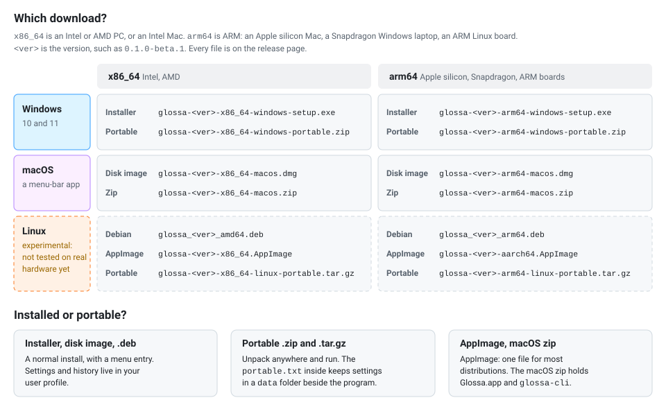

# Installing Glossa

In a hurry? [Getting started](getting-started.md) is the short version.
По-русски: [ru/install.md](ru/install.md). Installing on other people's
machines: [Deployment](deployment.md).

Every [release](https://github.com/bropines/glossa/releases) has these files
(`1.2.3` stands for the version). Each comes for two kinds of processor:
`x86_64` is an ordinary Intel or AMD PC and an Intel Mac, `arm64` is ARM
(Apple silicon Macs, Snapdragon Windows laptops, ARM Linux boards).

| system | file | what it is |
|---|---|---|
| Windows 10, 11 | `glossa-1.2.3-x86_64-windows-setup.exe`, `glossa-1.2.3-arm64-windows-setup.exe` | installer |
| | `glossa-1.2.3-x86_64-windows-portable.zip`, `glossa-1.2.3-arm64-windows-portable.zip` | portable archive |
| macOS 11+ Apple silicon | `glossa-1.2.3-arm64-macos.dmg` | disk image with `Glossa.app` |
| macOS 10.15+ Intel | `glossa-1.2.3-x86_64-macos.dmg` | the same, for Intel |
| | `glossa-1.2.3-*-macos.zip` | `Glossa.app`, `glossa-cli` and the documents |
| Debian 12, Ubuntu 22.04 and newer | `glossa_1.2.3_amd64.deb`, `glossa_1.2.3_arm64.deb` | package |
| other Linux | `glossa-1.2.3-x86_64.AppImage`, `glossa-1.2.3-aarch64.AppImage` | single file to run |
| | `glossa-1.2.3-x86_64-linux-portable.tar.gz`, `glossa-1.2.3-arm64-linux-portable.tar.gz` | portable archive |
| | `glossa-<version>-<target>.cdx.json` | a CycloneDX SBOM per platform: every crate in the two programs |
| | `SHA256SUMS` | checksums of every other file in the release |

`gh attestation verify <file> --repo bropines/glossa` checks that a file
was built by the repository's release workflow. The builds are not
code-signed: see the first-launch warnings below.

Every package carries `THIRD-PARTY-NOTICES.txt`, the licences of the
libraries inside the programs; *About Glossa* links to it.

The Linux builds have not been tried on real hardware yet: they are built
and smoke-tested by the release workflow only. Reports are welcome.

`Bropines.Glossa*.yaml` and `glossa.json` are winget and Scoop manifests (see
[below](#winget-and-scoop)).

Not sure which file to take? This chart picks one by system, processor and
installer or portable copy:

<p align="center">
  
</p>

- [System requirements](#system-requirements)
- [Windows](#windows): [the installer](#the-installer),
  [the portable archive](#the-portable-archive),
  [winget and Scoop](#winget-and-scoop)
- [macOS](#macos)
- [Linux](#linux): [Debian and Ubuntu](#debian-and-ubuntu),
  [AppImage](#appimage), [the archive](#the-archive)
- [Finding out about new versions](#finding-out-about-new-versions)
- [Where Glossa keeps your files](#where-glossa-keeps-your-files)
- [Removing Glossa completely](#removing-glossa-completely)
- [Accessibility](#accessibility)
- [Building the packages](#building-the-packages)

## System requirements

What the release workflow builds, and what those builds need. Nothing
else is built or tested.

| | supported | processors | state |
|---|---|---|---|
| Windows | 10 and 11 (the installer refuses older versions) | x86_64; arm64 | x86_64 is used daily by the author. The arm64 build has not been run on ARM hardware yet. |
| macOS | 11 or later on Apple silicon; 10.15 or later on Intel | arm64; x86_64 | Early testing, on Apple silicon. Run under Rosetta on Apple silicon, the Intel build's Apple Vision engine reads only Latin text, so take the arm64 build there. |
| Linux | Debian 12, Ubuntu 22.04 and distributions of that age or newer, with GTK 3 | x86_64; arm64 | Built and smoke-tested by the release workflow only; not tried on real hardware. |

There are no 32-bit builds, and none for Windows 7 or 8.

- **Graphics.** Windows are drawn with OpenGL by default. *Options →
  Appearance → Graphics engine* (or `GLOSSA_RENDERER`) switches to the GPU
  through Direct3D 12, Vulkan or Metal, or to a software rasteriser for
  machines without a working graphics driver. The oldest OpenGL version
  that works has not been measured.
- **Linux libraries.** GTK 3, ALSA and OpenGL from the system. The tray
  icon needs an AppIndicator library, and on GNOME the *AppIndicator and
  KStatusNotifierItem Support* extension. Under Wayland some features
  depend on the desktop's portals
  ([Troubleshooting](troubleshooting.md#linux-and-wayland)).
- **Disk.** The downloads of 0.1.0-beta.2 are 8 to 17 MB each (the macOS
  disk images the smallest, the Linux archives the largest). A release
  build for macOS on Apple silicon is 14 MB for `glossa` and 6.5 MB for
  `glossa-cli`; installed sizes on the other systems have not been
  measured. There is no web engine and no runtime to install.
- **Disk, optional.** What modules download on request is much larger
  than Glossa itself: the managed Python about 25 MB (65 MB unpacked) and
  `uv` about 15 MB for Python modules, the PaddleOCR module 30 to 45 MB,
  a local language model 1.1 to 1.3 GB.
- **Memory.** By the project's own figures, a few MB while Glossa waits
  in the tray with no window open (the window system is unloaded after 45
  seconds without one) and about 75 MB with windows loaded under OpenGL.
  Not measured again for this page, and not at all on Linux.
- **Network.** Not needed to install or start. The online services need
  it; [Privacy](privacy.md) lists what is contacted and what works
  offline.
- **Rights.** No administrator rights, except to install for all users on
  Windows or a `.deb` on Linux.

## Windows

### The installer

Run `glossa-…-windows-setup.exe`. It installs for your account only, into
`%LOCALAPPDATA%\Programs\Glossa`, and needs no administrator rights. The
first page offers to install for all users instead (into `Program Files`;
that asks for administrator rights).

It puts Glossa in the Start menu, and on request on the desktop. *Start
Glossa when I sign in to Windows* is the same switch as *Options → Basics →
Start with Windows*: either one can turn it on or off later.

Until the releases are signed, SmartScreen may stop the installer the first
time: *More info → Run anyway*. (The release workflow signs `glossa.exe`,
`glossa-cli.exe` and the installer as soon as the repository has a code
signing certificate in its secrets, `WINDOWS_SIGN_PFX` and
`WINDOWS_SIGN_PASSWORD`.)

Glossa runs without administrator rights. Windows does not let such a
program read or replace the selection in a program running as
administrator (an elevated terminal, say); start Glossa as administrator
too if you need that.

**Upgrading**: run the installer of the new version. It closes a running
Glossa first; your settings stay.

**Removing**: *Settings → Apps → Installed apps → Glossa → Uninstall*. It
asks whether to delete your settings, history and modules too; the answer
is no unless you say yes.

Take the `arm64` installer on an ARM laptop; the `x86_64` one also installs
there and runs under emulation, more slowly.

**Unattended installs** take the usual Inno Setup switches:

```bat
glossa-1.2.3-x86_64-windows-setup.exe /VERYSILENT /SUPPRESSMSGBOXES /CURRENTUSER
glossa-1.2.3-x86_64-windows-setup.exe /VERYSILENT /ALLUSERS /TASKS="desktopicon,autostart"
"%LOCALAPPDATA%\Programs\Glossa\unins000.exe" /VERYSILENT
```

A silent upgrade keeps "start with Windows" as it is, and starts Glossa
again in the tray if it was running. A silent uninstall keeps the settings.

### The portable archive

Unpack the `-portable.zip` anywhere (a USB stick, say) and run `glossa.exe`.
The `portable.txt` beside it keeps settings, history and modules in a `data`
folder next to `glossa.exe`, so the folder carries them along. To keep
them in `%APPDATA%\Glossa` instead, as the installer does, delete
`portable.txt` before the first start; once a `data` folder exists beside
`glossa.exe` it keeps the copy portable on its own, so move that away too.
To upgrade, unpack the new version over the old folder; `data` stays.

### winget and Scoop

Glossa is **not in the winget community repository yet and has no Scoop
bucket**: `winget install Bropines.Glossa` and `scoop install glossa` do
not find it. What exists is a manifest for each, attached to every release
with that release's URLs and checksums, which both tools can use directly:

- **Scoop**: `scoop install https://github.com/bropines/glossa/releases/download/v1.2.3/glossa.json`
  (put the release's tag in place of `v1.2.3`). It installs the portable
  archive for your processor, keeps its `data` folder across updates, and
  puts `glossa-cli` on the `PATH`. Installed from a URL, Scoop has no
  bucket to learn about later versions from: install the next release's
  manifest the same way.
- **winget**: download the three `Bropines.Glossa*.yaml` files into an
  empty folder and run `winget install --manifest <that folder>`. winget
  installs from local manifests only after an administrator has allowed
  it once: `winget settings --enable LocalManifestFiles`. The manifests
  have not been submitted to
  [winget-pkgs](https://github.com/microsoft/winget-pkgs) yet (they would
  go under `manifests/b/Bropines/Glossa/<version>/`).

## macOS

Take `arm64` for an Apple silicon Mac (M1 and later) and `x86_64` for an
Intel one. Open the `.dmg` and drag `Glossa.app` onto *Applications*. Glossa is a
menu-bar app: it has no Dock icon until one of its windows is open.

The app is signed ad hoc, not notarised, so macOS refuses the first launch.
On macOS 15 and later open it once, then *System Settings → Privacy &
Security → Open Anyway* (on older systems, right-click → Open). Or in
Terminal:

```bash
xattr -dr com.apple.quarantine /Applications/Glossa.app
```

The [README](../README.md#macos) lists the permissions it asks for.

**Upgrading**: quit Glossa from the menu bar, replace `Glossa.app` with the
new one, and grant the permissions again: macOS ties them to the app's
signature, which is different in every build
([how](troubleshooting.md#macos-permissions)). Your settings stay.

**Removing**: quit it from the menu bar and move `Glossa.app` to the Bin.
Settings stay in `~/Library/Application Support/Glossa`;
[below](#removing-glossa-completely) is the rest.

The `.zip` holds the same app plus `glossa-cli` and the documents. A Mac
app keeps its settings in the user's Library rather than beside itself; to
carry them elsewhere, start it with `GLOSSA_HOME` set (see
[Configuration](configuration.md)).

## Linux

Not yet tried on real hardware (see above). `x86_64` and `amd64` are for
ordinary PCs, `arm64` and `aarch64` for ARM machines (a Raspberry Pi 4 or 5
with a 64-bit system, ARM laptops).

### Debian and Ubuntu

```bash
sudo apt install ./glossa_1.2.3_amd64.deb     # or glossa_1.2.3_arm64.deb
```

apt pulls in what Glossa needs (GTK 3, ALSA, OpenGL) and, unless you turn
recommends off, Tesseract for offline text recognition and the AppIndicator
library for the tray icon. On GNOME the tray icon also needs the
*AppIndicator and KStatusNotifierItem Support* extension (Ubuntu has it).
Python modules use an installed `python3`, or a Python that Glossa
downloads for them on request (about 25 MB).

The package installs:

| path | what |
|---|---|
| `/usr/bin/glossa`, `/usr/bin/glossa-cli` | the programs |
| `/usr/share/applications/io.github.bropines.Glossa.desktop` | the menu entry |
| `/usr/share/icons/hicolor/256x256/apps/io.github.bropines.Glossa.png` | the icon |
| `/usr/share/metainfo/io.github.bropines.Glossa.metainfo.xml` | the description software centres show |
| `/usr/share/glossa/sdk/python/` | the Python module SDK, found by Glossa |
| `/usr/share/glossa/examples/modules/` | example modules, to copy into `~/.config/glossa/modules` |
| `/usr/share/doc/glossa/` | README, changelog, licences, `THIRD-PARTY-NOTICES.txt` |

`sudo apt remove glossa` removes it; your settings in `~/.config/glossa`
stay.

### AppImage

```bash
chmod +x glossa-1.2.3-x86_64.AppImage
./glossa-1.2.3-x86_64.AppImage                      # the desktop program
./glossa-1.2.3-x86_64.AppImage cli translate -t ru hello   # glossa-cli
```

It holds only Glossa itself and uses the system's GTK 3, ALSA and glibc. It
is built on Debian 12, like the `.deb`, so distributions of that age or
newer run it (Ubuntu 22.04, Fedora 37 and later). Running it
needs FUSE; without it, add `--appimage-extract-and-run`. Turning on *Start
at login* registers the AppImage file, so keep it where it is afterwards.

### The archive

Unpack the `-portable.tar.gz` anywhere and run `./glossa`; `./install.sh`
adds it to your application menu. It needs the same libraries as the
AppImage. As on Windows, `portable.txt` keeps the settings in `data/` next to
the program; to use `~/.config/glossa` instead, delete it and the `data/`
folder (if one was made already).

## Finding out about new versions

Glossa does not update itself. From the release after 0.1.0-beta.2,
*Options → Updates → Check now* asks GitHub
for the list of releases, and *Automatically check for updates* (off by
default) does that once a day; a new version only opens its release page
in your browser, and you install it as above. `glossa-cli update` asks the
same question from a terminal. `glossa --version` and `glossa-cli version`
print the version you have.

## Where Glossa keeps your files

| | Windows | macOS | Linux |
|---|---|---|---|
| settings, history, modules | `%APPDATA%\Glossa` | `~/Library/Application Support/Glossa` | `~/.config/glossa` |
| cache and log | `%LOCALAPPDATA%\Glossa` | `~/Library/Caches/Glossa` | `~/.cache/glossa` |
| module downloads (models, the managed Python) | `%LOCALAPPDATA%\Glossa` | `~/Library/Application Support/Glossa` | `~/.local/share/glossa` |

A `portable` file or a `data` folder next to the executable, or the
`GLOSSA_HOME` variable, moves all of them there; see
[Configuration](configuration.md).

On Linux and macOS, `config.toml` and `history.json` are written readable
by your account only (`0600`), in folders only you can open (`0700`).

API keys, the proxy password and the Lens token stay in the settings file
unless *Options → Basics* (or the welcome guide) puts them in the system
keychain: Windows Credential Manager, the macOS Keychain, or the Secret
Service on Linux. The keychain stays on the computer, so a portable copy
on a USB stick is better off with the file.

## Removing Glossa completely

The uninstallers remove the program and keep your data unless you say
otherwise. To leave nothing behind, turn off starting at login in
*Options → Basics* if it is on, quit Glossa (the tray or menu-bar icon →
*Exit*), and then:

**Windows**

1. *Settings → Apps → Installed apps → Glossa → Uninstall*, and answer
   *Yes* when it asks whether to delete your settings, history and
   modules. That removes `%APPDATA%\Glossa` and `%LOCALAPPDATA%\Glossa`
   (the log, caches and module downloads). A silent uninstall
   (`unins000.exe /VERYSILENT`) never deletes them: remove the two folders
   by hand.
2. Keys kept in the system keychain: *Control Panel → Credential Manager →
   Windows Credentials*, the entries whose names start with `Glossa/`.
3. A portable copy: delete its folder. If starting at login was still on,
   also the value `Glossa` under
   `HKCU\Software\Microsoft\Windows\CurrentVersion\Run` (Task Manager's
   *Startup apps* shows it).

**macOS**

1. Move `Glossa.app` to the Bin.
2. Delete `~/Library/Application Support/Glossa` (settings, history,
   modules and their downloads) and `~/Library/Caches/Glossa` (the log
   and caches).
3. Starting at login, if it was still on: delete
   `~/Library/LaunchAgents/app.glossa.plist`.
4. Keys: in *Keychain Access*, the login keychain, the items whose
   service is `Glossa`.
5. Permissions: remove Glossa from *Accessibility*, *Screen Recording* and
   *Input Monitoring* in *System Settings → Privacy & Security*, or:

   ```bash
   tccutil reset Accessibility io.github.bropines.glossa
   tccutil reset ScreenCapture io.github.bropines.glossa
   tccutil reset ListenEvent io.github.bropines.glossa
   ```

**Linux**

1. `sudo apt remove glossa`, or delete the AppImage or the unpacked
   archive. If you ran the archive's `install.sh`, also
   `~/.local/share/applications/io.github.bropines.Glossa.desktop` and
   `~/.local/share/icons/hicolor/256x256/apps/io.github.bropines.Glossa.png`.
2. Delete `~/.config/glossa` (settings, history, modules),
   `~/.cache/glossa` (the log and caches) and `~/.local/share/glossa`
   (module downloads).
3. Starting at login, if it was still on: delete
   `~/.config/autostart/glossa.desktop`.
4. Keys: in your desktop's password manager (Seahorse, KWallet), the
   entries for Glossa.

A copy started with `GLOSSA_HOME` keeps everything in that folder, and a
portable copy in `data` beside the program. Glossa installs no services,
drivers or browser extensions. Programs it only talks to (Tesseract,
chrome-lens-py, Ollama) are not its own and stay.

## Accessibility

What there is, and what there is not:

- **Scaling.** *Options → Appearance* scales the whole interface
  (0.75 to 2 there; `[appearance] ui_scale` in the settings file takes 0.5
  to 3) and the icons separately. *Options →
  Basics* sets the text size of the panes, and Ctrl + mouse wheel (or Ctrl
  with plus and minus) over a text area zooms that text alone.
- **Themes.** Light and dark themes, optionally following the system's
  mode; themes are plain files, so colours can be changed to taste
  ([Themes](theming.md)). There is no dedicated high-contrast theme.
- **Fonts.** *Options → Basics → Font name* picks any installed font.
- **Keyboard.** Every main action has a global hotkey or can be given one
  (*Options → Hotkeys*), and the main window has shortcuts for
  translating, clearing and swapping. Some things need the pointer:
  dragging and resizing the popup, selecting a screen region, and the
  popup's service strip, which shows on hover. Keyboard-only use of every
  window has not been tested.
- **Screen readers: not supported.** Glossa draws its own interface with
  egui instead of the system's controls, and its builds do not include
  egui's accessibility bridge (AccessKit). Narrator, NVDA, VoiceOver and
  Orca therefore get nothing to read from Glossa's windows. If you rely on
  a screen reader, [`glossa-cli`](cli.md) does the same translating,
  looking up and recognising in a terminal.
- **Reading aloud.** Translations can be spoken with the system's voices
  ([guide](guide.md#listening)).

Reports from people who use assistive technology are welcome
([SUPPORT.md](../SUPPORT.md)).

## Building the packages

The release workflow (`.github/workflows/release.yml`) builds everything on
a version tag. The scripts it calls work locally too:

| script | makes | needs |
|---|---|---|
| `packaging/linux/build-deb.sh <bin-dir> <version> [out]` | `glossa_<version>_<arch>.deb` | `dpkg-deb`, `dpkg-shlibdeps` (dpkg-dev) |
| `packaging/linux/build-appimage.sh <bin-dir> <version> [out]` | `glossa-<version>-<arch>.AppImage` | [appimagetool](https://github.com/AppImage/appimagetool) (`APPIMAGETOOL`, `APPIMAGE_RUNTIME`, `APPIMAGE_ARCH`: `x86_64` or `aarch64`) |
| `iscc /DMyAppVersion=<version> /DArch=<x64\|arm64> /DStageDir=<unpacked zip> packaging\windows\glossa.iss` | the Windows installer | Inno Setup 6.3+ |
| `packaging/fill-manifests.sh <version> <dist>` | winget and Scoop manifests | the setup `.exe` and portable `.zip` of both architectures in `<dist>` |

`<bin-dir>` holds `glossa` and `glossa-cli`, e.g.
`target/x86_64-unknown-linux-gnu/release`. The two Linux scripts also want
`THIRD_PARTY_NOTICES` pointing at the notices file written by
`scripts/third-party-notices.py --target <triple> -o <file>`, and stop
without it unless `ALLOW_NO_NOTICES=1` says it is a local try-out. Build the `.deb` on the oldest
system it should install on: its dependencies are read off that system's
libraries. The macOS disk images are made by `hdiutil` in the workflow.
The ARM builds for Windows and Linux are cross-compiled on x86-64 runners
(Linux against Debian's arm64 libraries, with `DEB_HOST_ARCH=arm64` for
`dpkg-shlibdeps`). Running the workflow by hand (*Actions → release → Run
workflow*) builds everything without making a release.
