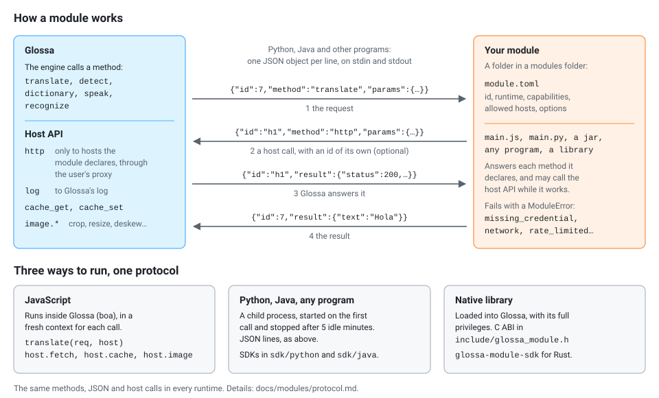
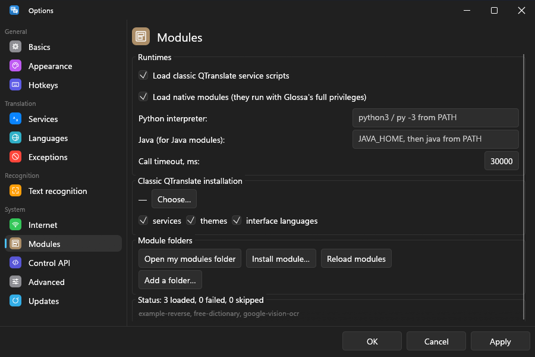

# Modules

Everything Glossa translates, looks up, speaks or recognises comes from a
**provider**. Some are built in (Google, Bing, DeepL, Yandex, Lens OCR…); the
rest are **modules**: folders Glossa finds at start-up and loads without
being rebuilt.



Every kind of module speaks the same [module protocol](protocol.md): the
same JSON requests, the same results, the same host calls. To the engine
they are interchangeable, and a module can move from one runtime to another
without reshaping its data.

## Contents

- [Your first module](#your-first-module)
- [Which runtime?](#which-runtime)
- [Where modules live](#where-modules-live)
- [module.toml](#moduletoml)
- [Trying a module](#trying-a-module)
- [Bundled modules](#bundled-modules)
- [Scripts from other programs](#scripts-from-other-programs)
- [Guides](#guides)

## Your first module

A JavaScript module needs nothing installed. Make a folder `hello` in your
modules folder ([where](#where-modules-live)) with two files.

`module.toml`:

```toml
capabilities = ["translate"]

[module]
id = "hello"
name = "Hello"
runtime = "js"
```

`main.js`:

```js
function translate(req, host) {
  return req.text.toUpperCase();
}
```

Then check that it loaded and call it:

```bash
glossa-cli modules                         # "hello" is listed as loaded
glossa-cli translate -s hello -t ru "it works"
```

In the desktop program, *Options → Modules → Reload modules* picks the new
folder up, and *Options → Services* lists "Hello" to switch on. A real
module calls a web service through `host.fetch`; the
[JavaScript guide](js-modules.md) shows how.

## Which runtime?

| kind | you write | runs as | good for | guide |
|---|---|---|---|---|
| JavaScript | `main.js` | inside Glossa (boa engine), a fresh context per call | web APIs: a few requests and some JSON | [js-modules.md](js-modules.md) |
| Python | `main.py` | a child process, started on first use, stopped when idle | anything needing Python libraries (ML models, `chrome-lens-py`, scraping) | [sdk/python](../../sdk/python/README.md) |
| Java | a `.jar` (Java, Kotlin, any JVM language) | a child process like Python, with Java found for you | JVM libraries and engines (Tess4J, ONNX Runtime for Java, Lucene), Kotlin code | [process-modules.md](process-modules.md#java-modules), [sdk/java](../../sdk/java/README.md) |
| Process | any program: `node main.mjs`, a Go or C# binary, a script | a child process like Python | any language with stdin and stdout; no SDK needed | [process-modules.md](process-modules.md) |
| Native | a `.dll` / `.so` / `.dylib` | loaded into Glossa | speed, offline engines, other languages with a C ABI (Rust, C, C++, Go, Zig) | [native-modules.md](native-modules.md) |

In short:

- A web API with JSON in and out: **JavaScript**. No process, no toolchain,
  nothing to install for the user.
- You need a Python library, or the code already exists in Python:
  **Python**. The process costs memory only while in use.
- The code is Java or Kotlin, or needs a JVM library: **Java**. Same process
  model as Python. The user needs a Java 17+ runtime, and Glossa says how to
  get one if it is missing.
- Any other language (Node, Go, C#, Ruby, a compiled binary): **process**.
  Read JSON lines on stdin, write them on stdout. No SDK, nothing linked
  into Glossa, and a crash only costs that one call.
- A local engine that must be as fast as possible, called from Rust, C, C++
  or Zig: **native**. No process boundary, but a crash in it takes Glossa
  down, so it is for code you trust.

| | JavaScript | Python | Java | process | native |
|---|---|---|---|---|---|
| user installs | nothing | Python 3.8+ | Java 17+ | the program's runtime | nothing |
| memory while idle | none | none (stopped) | none (stopped) | none (stopped) | the library |
| start-up | instant | tens of ms | a fraction of a second | the program's | instant |
| a crash takes down | the call | the call | the call | the call | Glossa |
| SDK | built in | `sdk/python` | `sdk/java` | none needed | `glossa-module-sdk`, `glossa_module.h` |

Python, Java and process modules share one transport (JSON lines over
stdio), so they behave identically.

Writing a text recognition module (a network OCR service, a local engine)?
[ocr-modules.md](ocr-modules.md) covers the result format (JSON layout, hOCR
or ALTO), the coordinate rules and the image API every runtime gets for
preprocessing.

## Where modules live

Glossa scans these folders, in order. A later one wins on a duplicate id.

1. `<folder of glossa.exe>/modules`
2. `<prefix>/share/glossa/modules` (a Unix install)
3. `<data folder>/modules`: `%APPDATA%\Glossa\modules` on Windows,
   `~/.config/glossa/modules` on Linux, `~/Library/Application Support/Glossa/modules`
   on macOS, or `data/modules` next to the executable in portable mode.

One module is one folder with a `module.toml`.

- *Options → Modules → Install module…* copies a folder or a `.potext` file
  into the last of these.
- *Reload modules* on the same page picks up changes without a restart.
- More folders can be added on the same page (`[modules] dirs` in
  `config.toml`).

```
modules/
├── free-dictionary/        a JavaScript module
│   ├── module.toml
│   └── main.js
├── lens-ocr/               a Python module
│   ├── module.toml
│   └── main.py
├── example-upper/          a Java module
│   ├── module.toml
│   └── module.jar
├── example-node/           a process module (Node.js)
│   ├── module.toml
│   └── main.mjs
└── shout/                  a native module
    ├── module.toml
    └── shout.dll
```

## module.toml

Only `id`, `name` and `runtime` are required. The full set:

```toml
capabilities = ["translate", "detect_language"]   # see below
languages = ["en", "ru", "de"]                    # omit for "all"

[module]
id = "my-translator"          # lowercase letters, digits, - _ . ; unique
name = "My Translator"        # shown in the UI
version = "1.0.0"
api = 1                       # module protocol major version
runtime = "js"                # js | python | java | process | native
entry = "main.js"             # main.js / main.py / module.jar / the library's file stem
description = "One line for the services list."
homepage = "https://example.com"
author = "You"
license = "MIT"
max_input_chars = 5000        # optional: longer text is cut at a word boundary
idle_timeout_secs = 300       # Python, Java, process: stop the process after this long unused
ready_to_use = true           # works with no key or setup: switched on when it first appears
# Python, Java and process modules only (see process-modules.md):
# command = ["node", "main.mjs"]   # process: the program; or command.windows / .macos / .linux / .unix / .default
# args = ["--quiet"]               # appended after the command, script or jar
# env = { KEY = "value" }          # environment for the process; ${MODULE_DIR} is the module's folder
# cwd = "."                        # working directory, relative to the module's folder
# main_class = "com.example.Main"  # java: run a class instead of `java -jar <entry>`
# classpath = ["classes", "lib/*"] # java: with main_class
# jvm_args = ["-Xmx64m"]           # java: JVM options

[language_map]                # optional: Glossa's code -> the service's
"zh-Hans" = "zh"
"he" = "iw"

[permissions]
network = ["api.example.com", "*.example.org"]   # "*" for any host; empty = no network

[[options]]                   # each becomes a field on the module's settings page
key = "api_key"
type = "secret"               # text | secret | url | bool | number | select | multiline
label = "API key"
help = "Get one at https://example.com/keys"
required = true

[[options]]
key = "formality"
type = "select"
label = "Formality"
default = "default"
choices = [{ value = "default", label = "Default" }, { value = "more", label = "Formal" }]

[[assets]]                    # files downloaded on demand: see Assets below
name = "model.onnx"
url = "https://example.com/model.onnx"
sha256 = "9f86d081884c7d659a2feaa0c55ad015a3bf4f1b2b0b822cd15d6c15b0f00a08"
size = 4718592
```

### Capabilities

They say which methods the module implements:

| capability | method | the module is offered as |
|---|---|---|
| `translate` | `translate` | a translator (main window, popup, service strip) |
| `detect_language` | `detect` | a language detector |
| `dictionary` | `dictionary` | a dictionary (dictionary window, single words) |
| `listen` | `speak` | text to speech |
| `ocr` | `recognize` | text recognition for screen regions ([guide](ocr-modules.md)) |

### Languages

Languages are BCP 47 codes: `en`, `ru`, `zh-Hans`, `zh-Hant`, `pt-BR`…
`glossa-cli services` and the languages list in the main window show the
full set. A source of `auto` means "detect it". If the service spells a
language differently, map it in `[language_map]` instead of in code.

### Permissions

Permissions limit the requests a module makes *through Glossa*
(`host.fetch` / `host.http`):

- A request to a host not on the list never leaves, and the module gets an
  error naming the permission.
- Those requests use the user's proxy settings and Glossa's timeouts and
  retries.
- A Python, Java, process or native module can open its own connections.
  Permissions do not cover those (they are ordinary programs), which is one
  reason to prefer the host calls.

### Switching on

Glossa keeps no fixed list of services. When a provider appears for the
first time (a built-in on the first run, your module the first time it
loads):

- it is switched on in the service strip if it declares
  `ready_to_use = true` and has no required options;
- otherwise it is only listed, for the user to switch on in
  *Options → Services*.

Either way the choice is remembered, so a service the user switched off
stays off.

### Options

Options are stored in the user's `config.toml` under
`[services.options.<module id>]`, and every request carries them as
`options`.

- When the user keeps secrets in the system keychain (`[general]
  secret_storage`), options of type `secret` are kept there instead. A
  module still receives the real value.
- A `required` option is marked with `*` on the settings page. When it is
  empty, fail with `missing_credential` and the option's key as the
  message, and Glossa tells the user which setting to fill in.

### Assets

A module that needs files too big for its folder (an ML model, a
dictionary, a helper program) lists them as `[[assets]]`. Glossa downloads
them into its own data folder, checks each against its SHA-256 and gives
the module their paths.

```toml
[[assets]]
name = "det"                         # saved as <assets folder>/det (a folder when unpacked)
url = ["https://example.com/det.tar.gz", "https://mirror.example.org/det.tar.gz"]  # or one string
sha256 = "…64 hex digits of the downloaded file…"
size = 4718592                       # bytes of the downloaded file
unpack = "tar.gz"                    # none (default) | zip | tar.gz | gz

[[assets]]
name = "ocr-helper"
url = "https://example.com/ocr-helper-win-x64.exe"
sha256 = "…"
size = 1048576
os = ["windows"]                     # windows | macos | linux | unix; omit for all
arch = ["x86_64"]                    # x86_64 | aarch64 | …; omit for all
executable = true                    # mark it runnable (Unix)

[[assets]]
name = "ru-en"
url = "https://example.com/models/ru-en.bin.gz"
sha256 = "…"
size = 17825792
unpack = "gz"
optional = true                      # fetched only when the user picks it
```

- **Names** are letters, digits, `.`, `-` and `_`. Two entries may share a
  name when their `os` / `arch` never overlap (a binary per system); the
  one that applies here is used.
- **When.** Nothing is downloaded at start-up. The module is listed, but
  it is not loaded (no process, no interpreter, no library) until its
  required files are there. The user downloads them from the module's
  settings (*Options → Services → the module*), with `glossa-cli assets
  download <id>` or through the control API; a call to the module before
  that fails with "needs its files downloaded" and the settings page
  offers the download. With `[modules] auto_download_assets = true` the
  first call downloads them instead.
- **Optional** assets (one language pair, voice or recogniser of many) do
  not hold the module back. They are downloaded one by one, by name; the
  `assets` host call says which are still missing.
- **Integrity.** A download resumes a partial file (`Range` requests), is
  checked against `sha256` and `size` before it is put in place, and is
  deleted if it does not match. Afterwards, knowing a file is ready costs a
  file-system check, never a re-hash; *Check files* (or `glossa-cli assets
  verify`) hashes them again. An unpacked archive is checked by its files
  and their sizes, since the archive itself is not kept.
- **Where.** `<local data>/Glossa/models/<module id>/` (`data/models/` in a
  portable copy). `glossa-cli assets status <id>` prints the folder.
- **Network.** Asset URLs need not be in `[permissions] network`: they are
  fixed in the manifest and checked by hash. Downloads use the user's
  proxy settings.

The module finds its files

| runtime | how |
|---|---|
| any | the `assets` host call: `{"dir": …, "files": {"det": "/…/det"}, "missing": […]}` ([protocol](protocol.md#assets)) |
| JavaScript | `host.assetPath("det")`, `host.assets()` |
| Python | `host.asset_path("det")`, `host.assets()` in the SDK |
| Java | `host.assetPath("det")`, `host.assets()` in the SDK |
| Python, Java, process | the environment: `GLOSSA_ASSETS_DIR`, and `GLOSSA_ASSET_DET` per asset (upper case, other characters as `_`) |
| Python, Java, process | `${ASSETS_DIR}` in `command`, `args`, `env`, `cwd`, `classpath` and `jvm_args`, e.g. `command = ["${ASSETS_DIR}/ocr-helper"]` |
| native | the `assets` host call |

## Trying a module

```bash
glossa-cli modules                          # what loaded, what failed and why
glossa-cli services -c dictionary           # who offers what
glossa-cli translate -s my-translator -t ru "Hello"
glossa-cli dict -s free-dictionary -f en serendipity
glossa-cli -v translate -s my-translator -t de "Hi"   # with the module's log lines
```

To test a module on its own, with cases you write beside it and recorded
answers instead of the network:

```bash
glossa-cli module test modules/my-translator   # checks, loads and runs tests/*.toml
```

[testing.md](testing.md) has the fixture format, a checklist for a new
module and the templates to start from.

`GLOSSA_HOME=<dir>` points Glossa at a separate data folder, handy for a
clean test with only your module in `<dir>/modules`. Each guide ends with
the debugging tips for its runtime.

*Options → Modules* shows the same list in the program, with what failed
and why:

<picture>
  <source media="(prefers-color-scheme: light)" srcset="../screenshots/options-modules-light.png">
  
</picture>

## Bundled modules

Some services ship inside Glossa as ordinary JavaScript modules. Their
sources live in [`modules/bundled/<id>/`](../../modules/bundled) in the
repository and are compiled into the executable (`include_str!` in
`crates/glossa-engine/src/bundled/`), so they need no files on disk. Each
`main.js` opens with a description of the service's protocol. All of them
work without a key or account and are switched on when they first appear.

| id | name | does | service |
|---|---|---|---|
| `yandex-web` | Yandex | translate, detect, dictionary | translate.yandex.net, the endpoint Yandex's browser clients use |
| `deepl-web` | DeepL | translate | the free endpoint of DeepL's iOS app (rate-limited after a burst) |
| `lara` | Lara | translate | laratranslate.com's web API |
| `modernmt` | ModernMT | translate | the form behind modernmt.com/translate |
| `multitran` | Multitran | dictionary | multitran.com result pages |
| `lingvo-live` | ABBYY Lingvo Live | dictionary | Lingvo Live's word-card JSON |
| `oxford-learners` | Oxford Learner's Dictionary | dictionary (English) | oxfordlearnersdictionaries.com entry pages |
| `wiktionary` | Wiktionary | dictionary | English Wiktionary's REST definitions |
| `youdao` | Youdao | dictionary (English, French, Chinese) | dict.youdao.com's JSON |
| `dic-academic` | Academic | dictionary | dic.academic.ru search |
| `translate-academic` | Academic Translations | dictionary | translate.academic.ru entries, as HTML |
| `wikipedia` | Wikipedia | dictionary | the Wikimedia REST page summary |
| `urban-dictionary` | Urban Dictionary | dictionary (English) | api.urbandictionary.com |

The keyed APIs stay Rust built-ins with names that say so: "Yandex Cloud (API
key)" (`yandex`) and "DeepL API (key)" (`deepl`).

**Changing one.** Bundled modules are registered before any module folder is
scanned, and a module with the same id replaces an earlier one.

1. Copy its folder from `modules/bundled/` into your modules folder.
2. Keep the `id`, edit, and *Reload modules*. `glossa-cli services` then
   shows it as `[JavaScript]` instead of `[Bundled]`.
3. Delete the copy to go back.

To hide one without replacing it, switch it off in *Options → Modules*
(`[modules] disabled` in `config.toml`).

## Scripts from other programs

Glossa also loads, without changes, scripts written for other programs:
classic **QTranslate** `Service.js` services and **pot-app** plugins
(`info.json` + `main.js`, or a `.potext` archive). See
[classic-scripts.md](classic-scripts.md).

## Guides

| guide | for |
|---|---|
| [js-modules.md](js-modules.md) | JavaScript modules |
| [sdk/python](../../sdk/python/README.md) | Python modules |
| [process-modules.md](process-modules.md) | Java, Kotlin, Node, Go, C# and any program over stdio |
| [sdk/java](../../sdk/java/README.md) | the Java SDK |
| [native-modules.md](native-modules.md) | shared libraries in Rust, C, C++, Zig |
| [ocr-modules.md](ocr-modules.md) | text recognition modules and the image API |
| [protocol.md](protocol.md) | the requests, results, errors and host calls every module uses |
| [testing.md](testing.md) | testing a module with `glossa-cli module test`, a checklist, templates, rules for AI agents |
| [classic-scripts.md](classic-scripts.md) | classic QTranslate services and pot-app plugins |
| [agents-template.md](agents-template.md) | an `AGENTS.md` to copy into your module's repository for an AI coding assistant |
