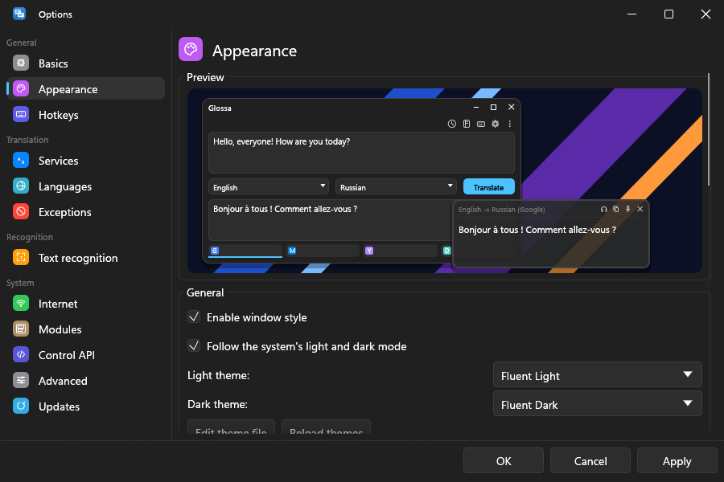

# Themes

Every colour and size the UI draws with comes from a theme, and a theme is a
file. Pick one in *Options → Appearance*; after editing a theme file, press
*Reload themes* there to see the change without restarting.

- [Built-in themes](#built-in-themes)
- [Light and dark with the system](#light-and-dark-with-the-system)
- [Where theme files go](#where-theme-files-go)
- [Writing one](#writing-one): [colours](#colours),
  [sections](#sections), [fonts](#fonts), [the system accent](#the-system-accent)
- [Backdrops](#backdrops)
- [Transparency](#transparency)
- [Readability](#readability)
- [Classic themes](#classic-themes)

## Built-in themes

| theme | looks like |
|---|---|
| **Glossa Dark**, **Glossa Light**, **Glossa Midnight** | Glossa's own. |
| **Fluent Dark**, **Fluent Light** | Windows 11 (WinUI 3) apps: Segoe UI Variable on the Windows type ramp, 32 px controls, 4 px control and 8 px window and menu corners, hairline strokes, thin scroll bars, the Fluent neutral palette and the system accent colour ([research/fluent.md](research/fluent.md) lists every number and where it comes from). |
| **macOS Dark**, **macOS Light** | macOS apps, after AppKit's colours and metrics, with 8 pt corners on menus and the popup. |

Themes from a classic QTranslate installation appear alongside them (see
[modules/classic-scripts.md](modules/classic-scripts.md)).

## Light and dark with the system

By default a new configuration follows the system's light or dark mode.
With *Options → Appearance → Follow the system's light and dark mode* on,
you pick one theme for light mode and one for dark, and Glossa switches
between them when the system does (it checks every few seconds, and at
once where the system reports the change). The defaults are the pair that looks native: Fluent Light and
Fluent Dark on Windows, macOS Light and macOS Dark on macOS, Glossa Light
and Glossa Dark elsewhere. With following off, or where the mode cannot be
told, the one theme chosen there is used.

<p align="center">
  
</p>

| system | where the mode is read |
|---|---|
| Windows | *Settings → Personalisation → Colours*, the app mode |
| macOS | *System Settings → Appearance* |
| Linux | `GTK_THEME` when set (a name with `dark` in it), else `gsettings` `color-scheme`, else the GTK theme's name |

The keys are `follow_system_theme`, `theme_light`, `theme_dark` and `theme`
in [`[appearance]`](configuration.md#appearance). A configuration written
before this setting existed keeps its one theme.

## Where theme files go

`<data folder>/themes/` (for example `%APPDATA%\Glossa\themes`), or `themes/`
next to the executable. A file's name, without the extension, is the theme's
name. `.toml` and `.json` are read.

## Writing one

Start from an existing theme and change only what you want:

```toml
# themes/Ocean.toml
extends = "Glossa Dark"
accent = "#1fa2a6"
selection = "#1fa2a670"

[window]
back = "#0f1c24"
client_back = "#0a141a"

[popup]
back = "#0f1c24"
frame = "#1fa2a6"
opacity = 0.9

[metrics]
button_radius = 6.0
window_radius = 8.0
```

`extends` names any theme the program knows (built-in, classic, or another
file). To see every field with its current value:

```bash
glossa-cli theme show "Glossa Dark"          # the full theme as TOML
glossa-cli theme show "Glossa Dark" > themes/Mine.toml
```

### Colours

`#rrggbb` or `#rrggbbaa` (alpha last: `#2a8de470` is the accent at 44 %).
The classic shorthand is accepted too: `"b"` is `#bbbbbb`, `"57"` is
`#575757`, `"39f"` is `#3399ff`.

### Sections

| section | what it styles |
|---|---|
| top level | `dark` (start from dark or light defaults), `accent` (a colour, or `"system"`), `accent_text`, `link`, `selection`, `error`, `warning`, `success` (text saying something is in order: a granted permission, "up to date"), `ai` (the plate behind the AI endpoints in the service strips) |
| `[window]` | window background, text, borders, the text panes' background (`client_back`), group frames |
| `[button.normal]`, `.hover`, `.pressed`, `.disabled` | buttons: `back_top` / `back_bottom` (classic themes' gradient ends; drawn as their mix), `border`, `text` |
| `[edit.normal]`, `.hover`, `.focused`, `.disabled` | text fields |
| `[window_button.*]` | minimise / maximise / close in the title bar of every window: `main` (the glyph), `back` (without one, WinUI's subtle hover fills; close always turns red on hover) |
| `[icon.*]` | toolbar and pane icons |
| `[popup]` | the selection popup: `back`, `text`, `frame`, `frame_thickness`, `opacity` |
| `[metrics]` | `button_radius`, `window_radius`, `spacing`, `padding`, `border_width`, `service_tab_height`, `icon_size`, `control_height` (0 = from the font), `overlay_radius` (menus and drop-downs; 0 = `button_radius`), `controls` (see below) |
| `[fonts]` | `family`, `size`, `fallbacks` (see below) |
| `[backdrop]` | fills used while a window backdrop is active (see *Backdrops*) |

A state that is not given falls back to `normal`.

`metrics.controls` is `"classic"` (the default) or `"fluent"`. Fluent
keeps every control the same size in every state (classic ones grow a
pixel under the pointer), uses thin scroll bars that widen under the
pointer, fills a slider's track up to the thumb with the accent, gives
menus WinUI's flyout shadow, a 1 px caret and secondary-coloured hint text,
and sizes captions 12 and headings 20 for a 14 px body. A theme extending
a Fluent theme inherits it.

### Fonts

`family` is the interface font. On Windows it is looked up by file name in
the Windows fonts folder, spaces ignored: `"Segoe UI"` finds `segoeui.ttf`,
and for a font whose file is named differently, give the file's stem
(`"consola"` for Consolas). On Linux and macOS it goes through fontconfig, so
any installed family name works. `fallbacks` are tried in order when
`family` is not found (the Fluent themes ask for `"Segoe UI Variable"`, then
its file name `"SegUIVar"`, then `"Segoe UI"` for Windows 10). Empty means Segoe UI on Windows and egui's
built-in face elsewhere. `size` is the interface size; the text panes' size
is a setting (*Options → Appearance*), not part of the theme.

Scripts the chosen font lacks (CJK, Arabic, Indic, Thai…) are filled from
system fonts automatically, each loaded only when such text first appears.
`text_family` and `text_size` are read but not used yet.

### The system accent

`accent = "system"` follows the accent colour chosen in the system's
personalisation settings (Windows; macOS's accent colour where available).
The colour the theme inherited stays as the fallback for systems without
one. When the system accent is applied, every colour in the theme that was
written as the accent, at any alpha (a focus border, a frame), takes the
system's shade for fills, colours written as `link` take its shade for
text, `selection` takes the base accent at the selection's alpha, and
`accent_text` is re-picked for contrast. The shades are Windows' own
(`light2` / `light3` on dark themes, `dark1` / `dark2` on light ones, as
WinUI uses them). Writing a colour for `accent` in a theme that extends a
system-accent theme turns the system accent off again.

`glossa-cli theme show` writes the flag as `accent_system = true` next to
the fallback `accent`; either spelling loads.

## Backdrops

*Options → Appearance* can put a system material behind the windows and,
separately, behind the popup:

| setting | Windows 11 22H2+ | Windows 11 21H2 | Windows 10 1803+ | macOS | Linux |
|---|---|---|---|---|---|
| `mica` | Mica | Mica | acrylic blur | window-background vibrancy | KWin blur (X11) |
| `micaalt` | Mica Alt | Mica | acrylic blur | under-window vibrancy | KWin blur (X11) |
| `acrylic` | Acrylic | acrylic blur | acrylic blur | popover vibrancy | KWin blur (X11) |
| `blur` | plain blur | plain blur | plain blur | full-screen-UI vibrancy | KWin blur (X11) |

Windows draws Mica and Acrylic (the 22H2 kinds) only while the window is
active, and a solid colour while it is not, as it does for its own apps.
The popup never takes focus, so there Mica and Acrylic both become the
older acrylic blur, which does not depend on activation. Windows 10 before
1803 gets plain blur for every kind. On other Linux desktops and on Wayland
there is no backdrop; the popup's *shade* is the fallback.

**Graphics engines.** On Windows backdrops and window transparency work
with every engine. With OpenGL the window's redirection surface carries
per-pixel alpha (winit's blur-behind trick). wgpu's usual swapchains, a
Vulkan one or DX12 made for the window handle, are opaque: DWM composes
nothing behind them. So while a backdrop or transparency is on, the GPU and
software engines use Direct3D 12 presenting to a DirectComposition visual
(wgpu's `Dx12SwapchainKind::DxgiFromVisual`, premultiplied alpha), and the
transparent windows are created without a redirection surface
(`WS_EX_NOREDIRECTIONBITMAP`, the eframe patch in `third_party/`), which is
how WinUI 3 windows are built. With neither on, wgpu keeps its default
backends. Turning backdrops or transparency on or off, like changing the
engine, takes a restart (switching between materials does not). On macOS backdrops need OpenGL: wgpu's Metal layer is opaque.

A material only shows where the window paints nothing or something
translucent, so while one is active the window draws its surfaces with the
theme's `[backdrop]` fills instead of its ordinary colours:

```toml
[backdrop]
window = "#00000000"      # the window body: let the material be the background
client = "#3a3a3a4c"      # panes and lists
edit = "#ffffff0f"        # text fields
popup = "#2c2c2c60"       # the selection popup
# For a surface without a colour, its ordinary colour's alpha times:
window_alpha = 0.0
client_alpha = 0.4
edit_alpha = 0.7
popup_alpha = 0.35
# A plain blur has no tint, so there every surface keeps at least this
# opacity of its ordinary colour.
untinted_min = 0.6
```

Every theme has workable defaults (the `*_alpha` factors), so classic themes
work with backdrops too; the Fluent themes give the WinUI tokens as colours.
The material is tinted dark or light to match the theme's `dark`.

**Backdrop opacity.** `[appearance] backdrop_opacity` and
`[appearance.popup] backdrop_opacity` (0 - 100 %, *Options → Appearance*)
scale how much colour covers the material, the way Windhawk's *Translucent
Windows* mod does: the alpha of Glossa's own `[backdrop]` fills, and for the
accent-policy acrylic (the popup, Windows 10, Windows 11 21H2) the tint the
compositor draws the blur with. 100 is the theme as made; 0 leaves only the
material (and, for acrylic, an untinted blur). Mica, Mica Alt, Windows 11's
own Acrylic and macOS vibrancy tint themselves and give no way to change
that tint, so there the slider only thins Glossa's fills.

`[appearance.popup] shade` (0 - 90) darkens a translucent popup when no
backdrop blurs what is behind it, so its text stays readable over a busy
page.

## Transparency

Two settings in *Options → Appearance*, independent of the theme:

- **Window transparency** for the main window and the other windows;
- **Popup transparency** for the selection popup (the theme's
  `popup.opacity` is the starting point).

Limits: turning window transparency on (from 0) or off needs a restart,
because the windows must be created with an alpha channel. It works with
all three engines; under GPU and software rendering on Windows the windows
then draw through a DirectComposition swap chain. While a window backdrop
is selected, the backdrop decides how see-through the windows are and the
slider is ignored. A text pane sits on the window body, so it ends up a
little more opaque than the body around it.

## Readability

Every theme is checked when it loads: text that does not reach WCAG AA
(4.5:1) against what it sits on (window body, panes, text fields, buttons,
the popup) takes the theme's most readable other text colour, or black or
white; disabled text only has to stay visible, and text on coloured plates
(the caption, the accent, hovered and pressed buttons) needs 2.5:1, which
keeps the classic white-on-blue looks. A theme whose colours already read
comes through unchanged.

`[window] caption_text` is the title bar's text when it differs from the
body text. Classic themes put the caption's text in `Window.Text` (Metro:
white on a blue caption, over a white body); it becomes `caption_text`, and
the labels take the theme's button or icon colour instead.

## Classic themes

Classic theme files (`Common`, `Window`, `Button`, `Edit`, `WindowButton`,
`Icon` sections, with `Normal` / `Hover` / `Pressed` / `Disabled` states and
`//` comments) load unchanged. To turn one into an editable native theme:

```bash
glossa-cli theme convert "C:\…\QTranslate\Themes\Flat Dark.json" > themes/Flat Dark.toml
```
