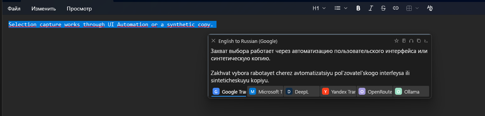

The second beta of **Glossa**, a clean-room successor to QTranslate, written in Rust. A small update over [beta.1](https://github.com/bropines/glossa/releases/tag/v0.1.0-beta.1).

## What's new

- **Support the project**: a link to the author's Boosty in the About window, the menus and the tray. Thank you!
- **macOS**: *Options → Exceptions* no longer lists Windows-only controls and rules that can never match on a Mac.
- The About window no longer has an empty band under its last button.

## Download

| Your system | Installer | Portable |
|---|---|---|
| **Windows 10, 11** (Intel / AMD) | [setup.exe](https://github.com/bropines/glossa/releases/download/v0.1.0-beta.2/glossa-0.1.0-beta.2-x86_64-windows-setup.exe) | [zip](https://github.com/bropines/glossa/releases/download/v0.1.0-beta.2/glossa-0.1.0-beta.2-x86_64-windows-portable.zip) |
| **Windows on ARM** (Snapdragon) | [setup.exe](https://github.com/bropines/glossa/releases/download/v0.1.0-beta.2/glossa-0.1.0-beta.2-arm64-windows-setup.exe) | [zip](https://github.com/bropines/glossa/releases/download/v0.1.0-beta.2/glossa-0.1.0-beta.2-arm64-windows-portable.zip) |
| **Mac with Apple silicon** (M1 and later) | [dmg](https://github.com/bropines/glossa/releases/download/v0.1.0-beta.2/glossa-0.1.0-beta.2-arm64-macos.dmg) | [zip](https://github.com/bropines/glossa/releases/download/v0.1.0-beta.2/glossa-0.1.0-beta.2-arm64-macos.zip) |
| **Mac with Intel** | [dmg](https://github.com/bropines/glossa/releases/download/v0.1.0-beta.2/glossa-0.1.0-beta.2-x86_64-macos.dmg) | [zip](https://github.com/bropines/glossa/releases/download/v0.1.0-beta.2/glossa-0.1.0-beta.2-x86_64-macos.zip) |
| **Linux** (x86_64) ⚠️ untested | [deb](https://github.com/bropines/glossa/releases/download/v0.1.0-beta.2/glossa_0.1.0-beta.2_amd64.deb) · [AppImage](https://github.com/bropines/glossa/releases/download/v0.1.0-beta.2/glossa-0.1.0-beta.2-x86_64.AppImage) | [tar.gz](https://github.com/bropines/glossa/releases/download/v0.1.0-beta.2/glossa-0.1.0-beta.2-x86_64-linux-portable.tar.gz) |
| **Linux** (ARM64) ⚠️ untested | [deb](https://github.com/bropines/glossa/releases/download/v0.1.0-beta.2/glossa_0.1.0-beta.2_arm64.deb) · [AppImage](https://github.com/bropines/glossa/releases/download/v0.1.0-beta.2/glossa-0.1.0-beta.2-aarch64.AppImage) | [tar.gz](https://github.com/bropines/glossa/releases/download/v0.1.0-beta.2/glossa-0.1.0-beta.2-arm64-linux-portable.tar.gz) |

The portable versions keep their settings in a `data` folder next to the program.

## First launch

The builds are not signed yet, so the system asks once:

- **Windows**: SmartScreen → *More info* → *Run anyway*.
- **macOS**: open Glossa once, then *System Settings → Privacy & Security → Open Anyway*. It lives in the menu bar and asks for Accessibility and Screen Recording.
- **Linux**: built and smoke-tested automatically, but not yet run on real hardware. Reports are very welcome.

## Known issues

- Windows on ARM builds have not been run on ARM hardware yet.
- The Intel Mac build running on Apple silicon (Rosetta) reads only Latin text with Apple Vision; use the Apple silicon build there.
- On Wayland, copy and paste into other programs need the desktop's remote-desktop portal (GNOME, KDE).

---

Full list of changes: [CHANGELOG.md](https://github.com/bropines/glossa/blob/v0.1.0-beta.2/CHANGELOG.md) · Install guide: [docs/install.md](https://github.com/bropines/glossa/blob/main/docs/install.md) · Bugs: [issues](https://github.com/bropines/glossa/issues) · Checksums: `SHA256SUMS`
