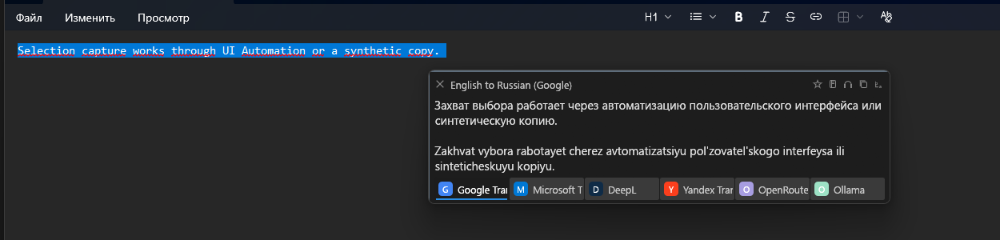

The first stable release of **Glossa**, a clean-room successor to QTranslate, written in Rust. It follows [beta.2](https://github.com/bropines/glossa/releases/tag/v0.1.0-beta.2).

## What's new since beta.2

- **Modules you install yourself**: from a folder or a `.zip`, removable in one click. A module does not run until you approve the hosts, programs and downloads it asks for; an update that asks for more waits again.
- **Presets**: named sets of services, dictionaries, voice and OCR engine to switch between in one click. They never hold keys or run programs.
- **Python modules without Python**: Glossa downloads a managed Python and gives each module its own environment.
- **PaddleOCR**: an offline text recognition module. Its program and models download on request.
- **Local LLM**: an offline translation module on llama.cpp, with no account and nothing sent anywhere.
- **Module editor** inside the program, and module windows and settings pages drawn by Glossa.
- **Interface language** switches at once, without a restart; your own language packs work too.
- **Working offline**: a built-in language detector and *Work offline* keep every request on the computer.
- **Control API**: the token is accepted only in the `Authorization` header, no longer in the address.
- **Windows fixes**: removing a running module, focus with *Open the main window with the popup*, and a silent exit on unknown command-line arguments.

## Download

| Your system | Installer | Portable |
|---|---|---|
| **Windows 10, 11** (Intel / AMD) | [setup.exe](https://github.com/bropines/glossa/releases/download/v0.1.0/glossa-0.1.0-x86_64-windows-setup.exe) | [zip](https://github.com/bropines/glossa/releases/download/v0.1.0/glossa-0.1.0-x86_64-windows-portable.zip) |
| **Windows on ARM** (Snapdragon) | [setup.exe](https://github.com/bropines/glossa/releases/download/v0.1.0/glossa-0.1.0-arm64-windows-setup.exe) | [zip](https://github.com/bropines/glossa/releases/download/v0.1.0/glossa-0.1.0-arm64-windows-portable.zip) |
| **Mac with Apple silicon** (M1 and later) | [dmg](https://github.com/bropines/glossa/releases/download/v0.1.0/glossa-0.1.0-arm64-macos.dmg) | [zip](https://github.com/bropines/glossa/releases/download/v0.1.0/glossa-0.1.0-arm64-macos.zip) |
| **Mac with Intel** | [dmg](https://github.com/bropines/glossa/releases/download/v0.1.0/glossa-0.1.0-x86_64-macos.dmg) | [zip](https://github.com/bropines/glossa/releases/download/v0.1.0/glossa-0.1.0-x86_64-macos.zip) |
| **Linux** (x86_64) ⚠️ untested | [deb](https://github.com/bropines/glossa/releases/download/v0.1.0/glossa_0.1.0_amd64.deb) · [AppImage](https://github.com/bropines/glossa/releases/download/v0.1.0/glossa-0.1.0-x86_64.AppImage) | [tar.gz](https://github.com/bropines/glossa/releases/download/v0.1.0/glossa-0.1.0-x86_64-linux-portable.tar.gz) |
| **Linux** (ARM64) ⚠️ untested | [deb](https://github.com/bropines/glossa/releases/download/v0.1.0/glossa_0.1.0_arm64.deb) · [AppImage](https://github.com/bropines/glossa/releases/download/v0.1.0/glossa-0.1.0-aarch64.AppImage) | [tar.gz](https://github.com/bropines/glossa/releases/download/v0.1.0/glossa-0.1.0-arm64-linux-portable.tar.gz) |

The portable versions keep their settings in a `data` folder next to the program.

## Upgrading from a beta

Install the new version as the [install guide](https://github.com/bropines/glossa/blob/main/docs/install.md) describes for your system; your settings stay. Key bindings that pass the control API token as `?token=…` need the `Authorization: Bearer …` header instead ([control API](https://github.com/bropines/glossa/blob/v0.1.0/docs/control-api.md)).

## First launch

The builds are not signed yet, so the system asks once:

- **Windows**: SmartScreen → *More info* → *Run anyway*.
- **macOS**: open Glossa once, then *System Settings → Privacy & Security → Open Anyway*. It lives in the menu bar and asks for Accessibility and Screen Recording.
- **Linux**: built and smoke-tested automatically, but not yet run on real hardware. Reports are very welcome.

## Known issues

- Windows on ARM builds have not been run on ARM hardware yet.
- The Intel Mac build running on Apple silicon (Rosetta) reads only Latin text with Apple Vision; use the Apple silicon build there.
- On Wayland, copy and paste into other programs need the desktop's remote-desktop portal (GNOME, KDE).

---

Full list of changes: [CHANGELOG.md](https://github.com/bropines/glossa/blob/v0.1.0/CHANGELOG.md#010---2026-11-17) · Install guide: [docs/install.md](https://github.com/bropines/glossa/blob/main/docs/install.md) · Bugs: [issues](https://github.com/bropines/glossa/issues) · Checksums: `SHA256SUMS`
